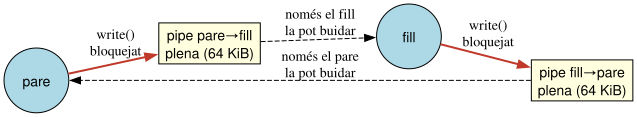
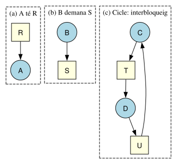
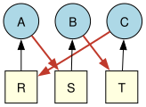
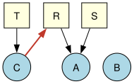
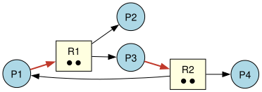
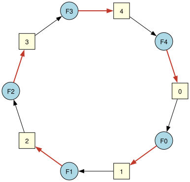

## Objectius de la sessió

::: {.objectius title="En acabar la sessió, has de ser capaç de"}
-   Definir amb precisió què és un **interbloqueig** i distingir-lo de la **inanició** i del **livelock**.
-   Enumerar les **quatre condicions** de Coffman i identificar-les en un exemple.
-   Dibuixar i interpretar un **graf d'assignació de recursos**.
-   Explicar com es **prevé** un interbloqueig trencant una de les condicions, i per què l'**ordre global** és la tècnica que es fa servir a la pràctica.
:::

::: {.prerequisits title="Necessites recordar"}
-   `fork`, `wait`, `pipe` i descriptors de fitxer.
-   Inanició i inversió de prioritats.
:::

# Un primer interbloqueig

## Dos processos que es parlen

``` c
int p2c[2], c2p[2];                  // pare->fill i fill->pare
pipe(p2c); pipe(c2p);
char *buf = calloc(n, 1);

if (fork() == 0) {                   // FILL
    write(c2p[1], buf, n);           // 1. envia-ho tot
    read(p2c[0], buf, n);            // 2. després llegeix
    exit(0);
}

write(p2c[1], buf, n);               // PARE: 1. envia-ho tot
read(c2p[0], buf, n);                //       2. després llegeix
wait(NULL);
```

::: {.reflexio title="Què passa?"}
El programa acaba amb:

- $n$ = 1 000 bytes? 
- I amb $n$ = 100 000?

:::

## Què ha passat?

::::: columns
::: {.column width="33%"}

```bash
$ ./pipes 1000
fill: fet
pare: fet
```

:::
::: {.column width="33%"}

```bash
$ ./pipes 65536
fill: fet
pare: fet
```

:::
::: {.column width="33%"}

```bash
$ ./pipes 100000
(no acaba mai)

```

:::
:::

::: {.fragment}

::::: columns
::: {.column width="55%"}
-   Una pipe té una capacitat limitada: a Linux, **64 KiB** per defecte.
-   Amb $n$ > 64 KiB, cada `write()` es **bloqueja** fins que l'altre llegeixi.
-   Però l'altre també està bloquejat al seu `write()`. **Cap dels dos arribarà mai al `read()`.**
:::

::: {.column width="45%" .fragment}
``` bash
$ ps -o pid,stat,wchan:20,comm -C pipes
  PID STAT WCHAN                COMMAND
  179 S    pipe_write           pipes
  181 S    pipe_write           pipes
```
:::
:::::

:::

:::{.fragment}
{width="100%"}
:::


## Què és un interbloqueig?

::: {.definicio title="Interbloqueig (deadlock)"}
Un conjunt de processos està en **interbloqueig** si cada procés del conjunt espera un esdeveniment que **només pot provocar un altre procés del conjunt**.
:::

-   Ningú del conjunt pot avançar, i per tant ningú provocarà l'esdeveniment: l'espera és **per sempre**.
-   Cal una intervenció **externa** (matar un procés, retirar-li un recurs) per sortir-ne.

::: {.fragment}
::: nonincremental 
| | Què passa | Es resol sol? |
|---|-----------|:-------------:|
| **Inanició** | Un procés espera indefinidament perquè sempre n'hi ha d'altres que passen davant | Pot resoldre's si canvien les circumstàncies |
| **Interbloqueig** | Espera circular: cada un espera un altre del conjunt | **Mai** |
| **Livelock** | Els processos no estan bloquejats: s'executen, però reaccionen l'un a l'altre sense avançar mai | Rarament |
:::
:::


# Recursos

## Recursos

-   **Recurs**: qualsevol cosa que un procés necessita i que, en un moment donat, pot ser d'un sol procés: un fitxer bloquejat, un dispositiu, una entrada d'una taula del kernel, espai en un buffer...
-   Ús d'un recurs: **petició → ús → alliberament**.
-   Si el recurs està ocupat, la petició pot:
    -   **bloquejar** el procés fins que s'alliberi (`flock(fd, LOCK_EX)`);
    -   **fallar** immediatament i deixar que el procés decideixi (`flock(fd, LOCK_EX | LOCK_NB)` → `EWOULDBLOCK`).

:::{.fragment}
::: nonincremental
| Tipus | Exemple | Què passa després d'usar-lo |
|-------|------------------|------------------------------|
| **Reutilitzable** | Fitxer bloquejat, impressora | S'allibera i un altre el pot fer servir |
| **Consumible** | Bytes d'una pipe, un missatge, un senyal | Desapareix; algú n'ha de produir més |
:::
:::

## Apropiables i no apropiables

-   **Apropiable**: el SO el pot retirar a un procés i tornar-l'hi més tard sense que se n'adoni.
    -   **CPU**: es desa el context al PCB (unitat 3).
    -   **Memòria**: es pot copiar a disc i recuperar (ho veurem a la unitat de memòria).
-   **No apropiable**: retirar-lo deixaria la feina a mitges i incoherent.
    -   Un fitxer bloquejat a mig actualitzar, una impressora a mig full.

::: {.concepte title="On hi ha interbloquejos" .fragment}
Els interbloquejos que estudiem són amb recursos **no apropiables**. Si es pogués retirar el recurs, el SO trencaria l'espera i no hi hauria interbloqueig.
:::

## Dos processos i dos fitxers

``` c
void proces(const char *f1, const char *f2) {
    int a = open(f1, O_RDWR | O_CREAT, 0644);
    int b = open(f2, O_RDWR | O_CREAT, 0644);
    flock(a, LOCK_EX);  printf("tinc %s\n", f1);
    sleep(1);
    flock(b, LOCK_EX);  printf("tinc %s i %s\n", f1, f2);
    exit(0);
}
// main: un fill fa proces("x.dat","y.dat"); l'altre, proces("y.dat","x.dat")
```

```bash
$ ./locks flock
A: tinc x.dat
B: tinc y.dat
A: demano y.dat
B: demano x.dat
(no acaba mai)
$ ps -o pid,stat,wchan:22,comm -C locks
  219 S    locks_lock_inode_wait  locks
  220 S    locks_lock_inode_wait  locks
```

# Les quatre condicions

## Condicions de Coffman (1971)

Hi ha interbloqueig **només si** es compleixen les quatre alhora:

::: nonincremental
| Condició | Significat | A l'exemple dels fitxers |
|----------|-----------|--------------------------|
| **1. Exclusió mútua** | Cada recurs és d'un sol procés alhora | `LOCK_EX`: un sol propietari |
| **2. Retenir i esperar** | Un procés que ja té recursos en demana més i espera | A té `x.dat` i espera `y.dat` |
| **3. No apropiació** | Un recurs només s'allibera voluntàriament | Ningú pot treure el bloqueig a A |
| **4. Espera circular** | Hi ha un cicle $P_1 \to P_2 \to \dots \to P_1$ on cada un espera el següent | A espera B, B espera A |
:::

-   Les quatre són **necessàries**: si en falla una, no hi pot haver interbloqueig.
-   Les tres primeres són **polítiques** del sistema; la quarta és el que **passa** en una execució concreta.

# Graf d'assignació de recursos

## Graf d'assignació de recursos

::::: columns
::: {.column width="45%"}
-   **Processos**: cercles. **Recursos**: quadrats.
-   **$P \to R$**: el procés $P$ **demana** el recurs $R$ (i espera).
-   **$R \to P$**: el recurs $R$ està **assignat** a $P$.
-   Una **espera circular** és un **cicle** al graf.
:::

::: {.column width="55%"}
{width="90%"}
:::
:::::

## L'ordre importa

Tres processos: A demana R i S; B demana S i T; C demana T i R (i després els alliberen).

::::: columns
::: {.column width="50%"}
**Ordre 1**: A→R, B→S, C→T, A→S, B→T, C→R

{width="70%"}

Cicle: **interbloqueig**.
:::

::: {.column width="50%"}
**Ordre 2**: A→R, C→T, A→S, C→R (B espera torn)

{width="70%"}

C espera A, però A pot acabar: **cap cicle**.
:::
:::::

-   Les **mateixes peticions** en un **altre ordre** no porten a interbloqueig: el SO podria triar l'ordre de concessió per evitar-lo.


## Una instància o diverses

-   **Una instància per recurs**: hi ha interbloqueig **si i només si** hi ha un cicle.
-   **Diverses instàncies** (per exemple, 2 impressores iguals): un cicle és **necessari però no suficient**.

::::: columns
::: {.column width="50%"}
{width="95%"}
:::

::: {.column width="50%"}
-   Hi ha un cicle: P1 → R1 → P3 → R2 → P1.
-   Però P2 i P4 no esperen res: acabaran i alliberaran una instància de R1 i de R2.
-   Llavors P1 i P3 podran continuar: **no hi ha interbloqueig**.
:::
:::::

# Què hi podem fer?

## Quatre estratègies

::: nonincremental
| Estratègia | Idea | 
|----|------|
| **Ignorar-lo** (estruç) | Si passa poc i costa molt evitar-lo, no fer res | 
| **Prevenir-lo** | Dissenyar el sistema perquè una de les quatre condicions no es pugui donar mai | 
| **Detectar i recuperar** | Deixar que passi, trobar-lo i trencar-lo | 
| **Evitar-lo** | Abans de concedir cada recurs, comprovar que no hi pot haver interbloqueig | 
:::

::: {.errorcomu title="Prevenir ≠ evitar" .fragment}
**Prevenir** és una decisió de **disseny**: el sistema no permet una de les condicions. **Evitar** és una decisió en **temps d'execució**: el sistema permet les quatre condicions, però tria a qui concedeix els recursos per no arribar mai a un cicle.
:::

# Prevenció

## Trencar l'exclusió mútua i la retenció

**1. Exclusió mútua**: que el recurs no sigui exclusiu.

-   *Spooling*: els processos no accedeixen a la impressora; deixen els treballs en una cua i un únic procés (el dimoni d'impressió) l'utilitza.
-   Fer el recurs compartible quan es pot: molts lectors alhora (`LOCK_SH`).
-   Límit: hi ha recursos que són exclusius per naturalesa.

**2. Retenir i esperar**: que ningú esperi tenint-ne un altre.

-   Demanar **tots** els recursos de cop, al principi.
-   O bé: abans de demanar-ne un de nou, **alliberar** tots els que es tenen.
-   Límits: cal saber per endavant què es necessitarà; es retenen recursos més temps del necessari; risc d'**inanició** si un procés necessita molts recursos alhora.

## Trencar la no apropiació i l'espera circular

**3. No apropiació**: permetre retirar recursos.

-   Si no pots obtenir el següent recurs, **deixa anar** els que tens i torna-ho a provar (`flock(..., LOCK_NB)`).
-   Risc: si tots ho fan al mateix ritme, **livelock**. Solució: esperar un temps **aleatori** abans de reintentar (*backoff*).
-   Només val per a recursos que es poden alliberar sense deixar res incoherent.

**4. Espera circular**: imposar un **ordre global**.

-   Numerem tots els recursos i **tothom els demana en ordre creixent**.
-   Exemple dels fitxers: sempre `x.dat` abans de `y.dat` (per ordre alfabètic, o per número d'inode).

::: {.concepte title="Per què funciona l'ordre global" .fragment}
Un cicle seria $P_1$ té $R_a$ i espera $R_b$, $P_2$ té $R_b$ i espera $R_c$, ..., $P_k$ té $R_z$ i espera $R_a$. Amb ordre creixent: $a < b < c < \dots < z < a$. **Impossible.**
:::

## Resum de la prevenció

::: nonincremental
| Condició que es trenca | Com | Inconvenient |
|-------|-----|--------------|
| Exclusió mútua | *Spooling*, recursos compartits | No sempre és possible |
| Retenir i esperar | Demanar-ho tot de cop / alliberar abans de demanar | Cal saber-ho per endavant; poca concurrència |
| No apropiació | Alliberar si no es pot continuar | Livelock; només per a alguns recursos |
| **Espera circular** | **Ordre global** | Cal disciplina (o eines que la comprovin) |
:::

# El sopar dels filòsofs

## El sopar dels filòsofs

::::: columns
::: {.column width="55%"}
-   5 filòsofs, 5 forquilles; per menjar, cal la de l'**esquerra** i la de la **dreta**.
-   Si tots agafen la de l'esquerra alhora: **interbloqueig**.
-   Ho provem amb **processos**: la forquilla $i$ és el **byte $i$** d'un fitxer, bloquejat amb `fcntl`.

``` c
void filosof(int i, int ordenat) {
    // esquerra, dreta
    int primera = i, segona = (i + 1) % N;            
    if (ordenat && primera > segona) { 
        primera = segona; segona = i; 
    }
    // força l'entrellaçat
    agafa(primera);  sleep(1);                         
    if (agafa(segona) == -1) { 
        printf("F%d: %s\n", i, strerror(errno)); exit(1); }
    printf("F%d: menja\n", i);  
    // en sortir, s'alliberen
    exit(0);               
}
```

:::

::: {.column width="45%"}
{width="80%"}
:::
:::::


## Resultats

::::: columns
::: {.column width="50%"}
```bash
$ ./filosofs
F0: tinc la forquilla 0
F1: tinc la forquilla 1
F2: tinc la forquilla 2
F3: tinc la forquilla 3
F4: tinc la forquilla 4
F3: forquilla 4 -> Resource deadlock avoided
F2: menja amb 2 i 3
...
```
:::

::: {.column width="50%"}
```bash
$ ./filosofs ordenat
F0: tinc la forquilla 0
F1: tinc la forquilla 1
F2: tinc la forquilla 2
F3: tinc la forquilla 3
F3: menja amb 3 i 4
F2: menja amb 2 i 3
...
F4: menja amb 0 i 4
```
:::
:::::

-   Sense ordre, els cinc tenen una forquilla i el cicle es tanca. Aquí el kernel l'ha **detectat** (`EDEADLK`) i ha fet fallar la petició de F3. Amb `flock` no ho hauria fet.
-   Amb ordre global, F4 no aconsegueix la forquilla 0 i espera **sense** retenir-ne cap: cap cicle.

## Tres solucions

::: nonincremental
| Solució | Regla | Condició que trenca |
|----|---------------------|---------------------|
| **Ordre** | Agafa primer la forquilla de número més petit | Espera circular |
| **Cambrer** | Com a molt $N-1$ filòsofs poden intentar menjar alhora | Espera circular (un sempre pot acabar) |
| **Regla del banquer** | No agafis una forquilla si després no quedaria ningú que en pogués tenir dues | Cap: **evita** l'estat perillós |
:::

::: {.reflexio title="Per què funciona el cambrer?" .fragment}
Amb 4 filòsofs i 5 forquilles, encara que cada un n'agafi una, en sobra una: algun veí la pot fer servir per menjar, acabar i alliberar-ne dues.
:::

## Resum

::: {.resum}
-   **Interbloqueig**: cada procés d'un conjunt espera un esdeveniment que només pot provocar un altre del conjunt. A diferència de la inanició, **no es resol sol**.
-   Depèn de les dades i de l'entrellaçat: un programa pot funcionar amb proves petites i penjar en producció.
-   **Quatre condicions necessàries**: exclusió mútua, retenir i esperar, no apropiació, espera circular.
-   Graf d'assignació: amb una instància per recurs, **cicle ⇔ interbloqueig**; amb diverses, el cicle no és suficient.
-   **Prevenir** = dissenyar perquè una condició no es doni mai. A la pràctica: **ordre global** de petició dels recursos.
:::
