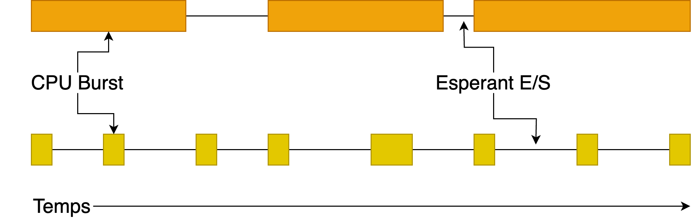
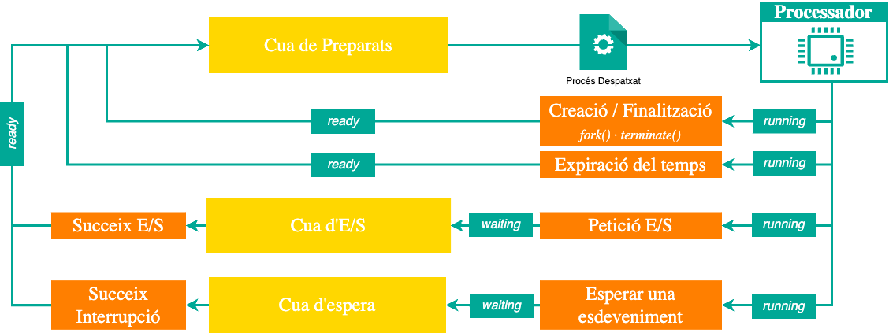
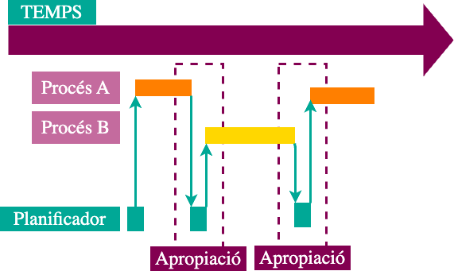

## Objectius de la sessió

::: {.objectius title="En acabar la sessió, has de ser capaç de"}
-   Distingir el **mecanisme** (com es canvia de procés) de la **política** (quin procés s'executa).
-   Identificar els **quatre punts de decisió** del planificador i relacionar-los amb l'**apropiació**.
-   Definir i calcular les mètriques de planificació: retorn, espera, resposta, retorn normalitzat, utilització i productivitat.
-   Planificar a mà amb **FCFS** i **Round Robin** i justificar l'elecció del quantum.
:::

::: {.prerequisits title="Necessites recordar"}
-   Estats d'un procés i transicions
-   Interrupcions, crides a sistema i canvi de context.
:::

# Mecanisme i política

## Dues preguntes diferents

``` {.c code-line-numbers="false"}
while (true) {
    if (hi_ha_preparats(cua)) {
        seguent = selecciona(cua);   // POLÍTICA: quin?
        executa(seguent);            // MECANISME: com?
    } else {
        executa_idle();
    }
}
```

-   **Mecanisme**: com aturem un procés i en reprenem un altre sense que se n'adonin: desar i restaurar context, canviar d'espai d'adreces.
  
-   **Política**: entre tots els preparats, **quin** s'executa ara i durant quant de temps. 


::: notes
Separar mecanisme i política és un principi de disseny de SO: podem canviar la política sense tocar el mecanisme. La rutina `selecciona()` és l'única cosa que canvia entre FCFS, RR, SJF o MLFQ. El despatxador (mecanisme) sempre fa el mateix: canvi de context, canvi de mode, salt a la instrucció del procés escollit. El temps que triga s'anomena latència de despatx.
:::

## Ràfegues de CPU i d'E/S

Els processos alternen **ràfegues de CPU** (*bursts*) i **esperes d'E/S**.

{width="75%"}

-   **Limitat per CPU** (*CPU-bound*): poques ràfegues, llargues.
-   **Limitat per E/S** (*I/O-bound*): moltes ràfegues, curtes.
-   Empíricament, la majoria de ràfegues són **curtes**: la distribució està molt concentrada en pocs mil·lisegons.

::: notes
Cada decisió de planificació és, de fet, una decisió sobre a qui donem la CPU per a la seva propera ràfega. Aquesta idea serà clau per entendre SJF a la sessió 04b: el que es vol conèixer no és la durada total del procés sinó la de la propera ràfega.
:::

## Per què cal planificar?

{width="70%"}

-   Amb **multiprogramació** hi ha diversos processos preparats a memòria i una sola CPU.
-   Mentre un procés espera E/S, la CPU pot servir-ne un altre.
-   Algú ha de decidir l'ordre: el **planificador**.

::: notes
Recordeu la diferència amb un sistema monoprogramat: només un procés a memòria, i quan espera E/S la CPU queda ociosa. La multiprogramació aprofita aquests forats; la planificació decideix com omplir-los.
:::

## Supòsits simplificadors

Per estudiar les polítiques clàssiques assumirem:

-   **Una sola CPU** i un fil per procés.
-   Processos **independents** (no comparteixen locks ni s'esperen entre ells).
-   Canvi de context de cost **zero**, llevat que es digui el contrari.

::: {.reflexio title="Són realistes?" .fragment}
No. Però permeten raonar i comparar polítiques. Quan els trenquem (diversos fils, locks, cost de canvi de context) apareixen problemes nous, com la **inversió de prioritats**.
:::

# Quan es planifica

## Els quatre punts de decisió

{width="70%"}

::: nonincremental
1.  **Execució → Espera**: el procés demana E/S o fa `wait()`.
2.  **Execució → Preparat**: interrupció de rellotge (s'acaba el quantum).
3.  **Espera → Preparat**: finalitza una E/S que el procés esperava.
4.  **Finalització**: el procés crida `exit()`.
:::

::: notes
En els casos 1 i 4 el procés deixa la CPU voluntàriament: no hi ha opció, cal triar-ne un altre. En els casos 2 i 3 el SO podria deixar continuar el procés actual o canviar-lo. Aquesta és exactament la diferència entre una política no apropiativa i una d'apropiativa.
:::

## Apropiació

::: {.definicio title="Planificació apropiativa (preemptive)"}
El SO pot **retirar la CPU** a un procés que encara la vol utilitzar, en els punts 2 i 3, normalment gràcies a la **interrupció de rellotge**.
:::

{width="55%"}

-   **No apropiativa**: només es planifica als punts 1 i 4. Un procés conserva la CPU fins que es bloqueja o acaba.
-   **Apropiativa**: millor temps de resposta i justícia, a canvi de més **canvis de context** i d'haver de protegir les dades del nucli.

# Criteris de planificació

## Mètriques per procés

:::{.columns}
:::: {.column width="50%"}

::: nonincremental
| Dada          | Significat                                  |
|---------------|---------------------------------------------|
| $T_a$         | instant d'arribada a la cua de preparats    |
| $T_{inici}$   | instant de la primera execució              |
| $T_f$         | instant de finalització                     |
| $T_{cpu}$     | temps total de CPU que necessita            |
:::

:::
:::: {.column width="50%"}

::: nonincremental
| Mètrica                | Fórmula                                    |
|------------------------|--------------------------------------------|
| Temps de retorn        | $T_{retorn} = T_f - T_a$                   |
| Temps d'espera         | $T_{espera} = T_{retorn} - T_{cpu}$ (sense E/S) |
| Temps de resposta      | $T_{resposta} = T_{inici} - T_a$           |
| Retorn normalitzat     | $T_{N} = T_{retorn} / T_{cpu}$ ($\geq 1$)  |
:::

:::
:::

::: notes
Si el procés fa E/S, el temps d'espera és el temps acumulat a la cua de preparats: T_retorn - T_cpu - T_E/S (suposant que els dispositius no tenen cua). El retorn normalitzat mesura quantes vegades més ha trigat respecte a si hagués tingut la CPU per a ell sol: un 1 és perfecte; un 5 vol dir que ha trigat 5 vegades el que necessitava. Penalitza molt els processos curts maltractats.
:::

## Mètriques del sistema

-   **Utilització de la CPU**: $\dfrac{\text{temps de CPU ocupada}}{\text{temps total}}$.
-   **Productivitat** (*throughput*): $\dfrac{\text{processos completats}}{\text{temps total}}$ (en processos per unitat de temps).
-   Per comparar polítiques usem **mitjanes**: $\bar{T}_{retorn}$, $\bar{T}_{espera}$, $\bar{T}_{resposta}$.

::: {.errorcomu title="Temps de resposta» no és «temps de retorn" .fragment}
En aquest curs, $T_{resposta}$ és el temps fins a la **primera** execució. Molts textos anomenen *response time* al temps de **compleció** d'una operació.
:::

## Objectius en conflicte

-   **Sistemes per lots**: maximitzar la utilització i la productivitat, minimitzar $\bar{T}_{retorn}$.
-   **Sistemes interactius**: minimitzar $T_{resposta}$ (eco d'una tecla, obrir una finestra).
-   **Temps real**: complir terminis de manera **predictible**.
-   **Sempre**: **justícia** (cap procés queda sense CPU indefinidament) i **equilibri** (CPU i dispositius ocupats alhora).

::: {.concepte title="No hi ha política òptima per a tot" .fragment}
Millorar el temps mitjà pot exigir ser injust amb alguns processos, i reduir el temps de resposta obliga a fer més canvis de context, que redueixen la productivitat. L'elecció depèn de la càrrega i dels objectius del sistema.
:::

# FCFS

## FCFS: First-Come, First-Served

-   Una cua **FIFO**: s'executa el procés que fa més temps que espera.
-   **No apropiatiu**: el procés conserva la CPU fins que es bloqueja o acaba.
-   Trivial d'implementar i **sense inanició** (si els processos acaben).

::: {.exemple title="L'ordre d'arribada ho decideix tot" .fragment}
P1 = 24, P2 = 3, P3 = 3, tots arriben a $t=0$.
 
::: nonincremental
| Ordre          | Espera (P1, P2, P3) | $\bar{T}_{espera}$ | $\bar{T}_{retorn}$ |
|----------------|---------------------|--------------------|--------------------|
| P1, P2, P3     | 0, 24, 27           | 17                 | 27                 |
| P2, P3, P1     | 6, 0, 3             | 3                  | 13                 |
:::
:::

::: notes
Mateixa càrrega, mateixa política, i el temps d'espera mitjà passa de 17 a 3 només canviant l'ordre d'arribada. FCFS no té cap control sobre la qualitat del resultat.
:::

## Efecte comboi

::: {.definicio title="Efecte comboi (convoy effect)"}
Amb una política no apropiativa, un procés llarg a la CPU fa que s'hi acumulin al darrere molts processos curts.
:::

-   Típic: un procés limitat per CPU i molts limitats per E/S.
-   Mentre el llarg té la CPU, els curts esperen i els **dispositius queden ociosos**.
-   Quan el llarg es bloqueja, els curts passen ràpid per la CPU i la **CPU queda ociosa**.
-   Resultat: mala utilització **de tot** el sistema, no només mal temps d'espera.

## Exercici 01: FCFS

::: {.exercici title="Planifica amb FCFS"}
::: nonincremental
| Procés | $T_a$ | $T_{cpu}$ |
|--------|-------|-----------|
| A      | 0     | 7         |
| B      | 2     | 4         |
| C      | 3     | 2         |
:::

1.  Dibuixa el diagrama de Gantt.
2.  Calcula la utilització de la CPU, la productivitat, $\bar{T}_{espera}$, $\bar{T}_{retorn}$ i $\bar{T}_N$.
3.  On es veu l'efecte comboi?
:::

## Exercici 01: solució {.smaller}

::: {.solucio title="FCFS"}
::: nonincremental
| $t$ | 0 | 1 | 2 | 3 | 4 | 5 | 6 | 7 | 8 | 9 | 10 | 11 | 12 |
|-----|---|---|---|---|---|---|---|---|---|---|----|----|----|
| CPU | A | A | A | A | A | A | A | B | B | B | B  | C  | C  |

| Procés | $T_f$ | $T_{retorn}$ | $T_{espera}$ | $T_N$ |
|--------|-------|--------------|--------------|-------|
| A      | 7     | 7            | 0            | 1     |
| B      | 11    | 9            | 5            | 2.25  |
| C      | 13    | 10           | 8            | 5     |
| **Mitjana** |  | **8.67**     | **4.33**     | **2.75** |
:::

-   Utilització $= 13/13 = 100\%$; productivitat $= 3/13 \approx 0.23$ processos/u.t.
-   **Comboi**: C només necessita 2 unitats però n'espera 8. És qui té el pitjor $T_N$ (5).
:::

# Round Robin

## Round Robin (RR)

FCFS **amb apropiació**: cada procés rep com a màxim un **quantum** $q$ de CPU; si no ha acabat, torna al **final** de la cua.

-   S'implementa amb una cua FIFO i la **interrupció de rellotge**.
-   Amb $n$ processos preparats, cadascun rep $1/n$ de la CPU en trossos de com a màxim $q$.
-   **Fita**: cap procés espera més de $(n-1)\,q$ **entre dos torns consecutius**. Per tant, $T_{resposta} \leq (n-1)\,q$ si tots arriben alhora.

::: {.errorcomu title="La fita no és el temps d'espera total" .fragment}
$(n-1)\,q$ fita l'espera **entre torns**. El $T_{espera}$ total d'un procés llarg és la suma de moltes d'aquestes esperes i pot ser molt més gran.
:::

## RR: diagrama de flux

```{mermaid}
%%| echo: false
flowchart LR
    classDef iniciFi fill:#00A896,color:white,stroke:#007D6C,stroke-width:2px,font-size:22px;
    classDef decisio fill:#C46B9E,color:white,stroke:#963D6D,stroke-width:2px,font-size:22px;
    classDef proces fill:#fff,color:#333,stroke:#00A896,stroke-width:2px,font-size:22px;

    A[[Treure el primer<br>de la cua]]:::proces --> B[[Executar fins a<br>q o fins que deixi la CPU]]:::proces
    B --> C{Què ha passat?}:::decisio
    C -->|Quantum esgotat| D[[Al final de<br>la cua]]:::proces
    C -->|Bloqueig E/S| E[[Cua d'E/S]]:::proces
    C -->|Acaba| F([Fi del procés]):::iniciFi
    D --> A
    E -->|E/S completada| D
    F --> A
```

::: notes
Fixeu-vos que el procés pot deixar la CPU abans d'esgotar el quantum: perquè acaba o perquè es bloqueja. Només en el primer cas l'expulsa el rellotge. Quan torna d'E/S entra pel final de la cua, com qualsevol arribada.
:::

## RR: elecció del quantum

-   $q \to \infty$: tornem a tenir **FCFS**.
-   $q$ massa gran: el temps de resposta empitjora. Els primers UNIX usaven $q = 1\,s$: amb tres compilacions en marxa, l'eco d'una tecla podia trigar 3 s.
-   $q$ massa petit: gairebé tot el temps se'n va en **canvis de context** i la productivitat cau.
-   Valors típics actuals: $q \approx 10$–$100\,ms$ amb un canvi de context de $0.1$–$1\,ms$, és a dir una sobrecàrrega del voltant de l'**1 %**.

::: {.reflexio title="El quantum ha de ser gran respecte al canvi de context" .fragment}
Si $q = 1\,ms$ i el canvi de context costa $1\,ms$, quin percentatge de CPU fa feina útil?
:::

::: notes
Resposta: el 50 %. La meitat del temps la CPU només canvia de procés. A més, cada canvi refreda les memòries cau, un cost que no es veu a la fórmula.
:::

## RR amb $q = 20$: exemple

::::: columns
::: {.column width="35%"}
::: nonincremental
| $p$   | $T_a$ | $T_{cpu}$ |
|:-----:|:-----:|:---------:|
| 🟢 P1 | 0     | 53        |
| 🔵 P2 | 0     | 8         |
| 🟣 P3 | 0     | 68        |
| 🟠 P4 | 0     | 24        |

|                | P1  | P2 | P3  | P4  | Mitjana |
|----------------|-----|----|-----|-----|---------|
| $T_{espera}$   | 72  | 20 | 85  | 88  | 66.25   |
| $T_{retorn}$   | 125 | 28 | 153 | 112 | 104.5   |
:::
:::

::: {.column width="65%"}
```{mermaid}
%%| echo: false
gantt
    title Round Robin (q = 20)
    dateFormat X
    axisFormat %s

    section Execució
    🟢 P1 : 0, 20
    🔵 P2 : 20, 28
    🟣 P3 : 28, 48
    🟠 P4 : 48, 68
    🟢 P1 : 68, 88
    🟣 P3 : 88, 108
    🟠 P4 : 108, 112
    🟢 P1 : 112, 125
    🟣 P3 : 125, 153
```
:::
:::::

::: notes
Espera de P1: (68-20) + (112-88) = 72. P2 acaba a 28 tot i necessitar només 8: el pitjor que li pot passar és esperar un torn de cadascun dels altres, (n-1)q = 60, però aquí li toca després de P1 i espera 20.
:::

## Impacte del quantum {.smaller}

Mateixa càrrega (P1 = 53, P2 = 8, P3 = 68, P4 = 24):

::: nonincremental
| Política     | Espera P1 | P2  | P3 | P4  | $\bar{T}_{espera}$ | $\bar{T}_{retorn}$ |
|--------------|-----------|-----|----|-----|--------------------|--------------------|
| Millor FCFS  | 32        | 0   | 85 | 8   | 31.25              | 69.5               |
| $q = 1$      | 84        | 22  | 85 | 56  | 61.75              | 100                |
| $q = 5$      | 82        | 20  | 85 | 58  | 61.25              | 99.5               |
| $q = 8$      | 80        | 8   | 85 | 56  | **57.25**          | **95.5**           |
| $q = 10$     | 82        | 10  | 85 | 68  | 61.25              | 99.5               |
| $q = 20$     | 72        | 20  | 85 | 88  | 66.25              | 104.5              |
| Pitjor FCFS  | 68        | 145 | 0  | 121 | 83.5               | 121.75             |
:::

::: {.reflexio title="Què n'aprenem?"}
-   RR **no** millora la millor FCFS en temps mitjà: la seva virtut és que **no depèn de l'ordre** i no té casos catastròfics.
-   L'efecte de $q$ **no és monòton**: $q = 8$ (just la ràfega de P2) és el millor RR d'aquesta càrrega.
:::

::: notes
Taula recalculada per simulació. La transparència original de Berkeley (CS162, Lec 11) té una errata a la fila q=1: hi posa P4 = 57 (acabant a 81); el valor correcte és 56 (acaba a 80). Millor FCFS: ordre P2, P4, P1, P3. Pitjor FCFS: P3, P1, P4, P2.
:::

## RR és sempre millor que FCFS?

::: {.reflexio title="Suposem canvi de context gratuït"}
10 tasques de 100 s cadascuna arriben a $t = 0$; RR amb $q = 1\,s$.
:::

::: fragment
::: nonincremental
| Tasca      | Finalització FCFS | Finalització RR |
|------------|-------------------|-----------------|
| 1          | 100               | 991             |
| 2          | 200               | 992             |
| ...        | ...               | ...             |
| 10         | 1000              | 1000            |
| **Mitjana**| **550**           | **995.5**       |
:::
:::

-   Totes dues acaben a $t = 1000$: la **productivitat és idèntica**.
-   El **retorn mitjà** gairebé es duplica amb RR: quan totes les tasques són iguals, repartir només endarrereix tothom.
-   I a la realitat és pitjor: amb RR les 10 tasques es reparteixen la memòria cau; amb FCFS cadascuna la té tota.

## Exercici 02: RR amb $q = 1$

::: {.exercici title="Planifica amb RR (q = 1)"}
::: nonincremental
| Procés | $T_a$ | $T_{cpu}$ |
|--------|-------|-----------|
| A      | 0     | 7         |
| B      | 2     | 4         |
| C      | 3     | 2         |
:::

1.  Dibuixa el diagrama de Gantt.
2.  Calcula $\bar{T}_{espera}$, $\bar{T}_{retorn}$, $\bar{T}_{resposta}$ i $\bar{T}_N$.
3.  Compara amb l'exercici 01.
:::

::: {.examtip title="Conveni de desempat" .fragment}
Si en un mateix instant arriba un procés nou i un altre és expulsat per fi de quantum, **el nou entra primer** a la cua. Indiqueu sempre el conveni que feu servir.
:::

## Exercici 02: solució {.smaller}

::: {.solucio title="RR (q = 1)"}
::: nonincremental
| $t$  | 0 | 1 | 2 | 3   | 4   | 5   | 6   | 7   | 8 | 9 | 10 | 11 | 12 |
|------|---|---|---|-----|-----|-----|-----|-----|---|---|----|----|----|
| CPU  | A | A | B | A   | C   | B   | A   | C   | B | A | B  | A  | A  |
| Cua  | – | – | A | C,B | B,A | A,C | C,B | B,A | A | B | A  | –  | –  |

| Procés | $T_f$ | $T_{retorn}$ | $T_{espera}$ | $T_{resposta}$ | $T_N$ |
|--------|-------|--------------|--------------|----------------|-------|
| A      | 13    | 13           | 6            | 0              | 1.86  |
| B      | 11    | 9            | 5            | 0              | 2.25  |
| C      | 8     | 5            | 3            | 1              | 2.5   |
| **Mitjana** |  | **9**        | **4.67**     | **0.33**       | **2.20** |
:::

-   Respecte a FCFS: $\bar{T}_{resposta}$ passa de 4.33 a 0.33 i $\bar{T}_N$ de 2.75 a 2.20, però $\bar{T}_{espera}$ empitjora (4.33 → 4.67).
-   A $t=3$: arriba C i B és expulsat alhora; per conveni C entra abans que B.
:::

::: notes
Compte: A acaba a 13 però només necessita 7, per tant T_N(A) = 13/7 = 1.86, no 1. Aquest és un error molt freqüent: el retorn normalitzat es calcula amb el T_retorn de cada procés en aquesta política, no amb el de FCFS.
:::

## Resum

-   **Política ≠ mecanisme**: avui hem vist quin procés triar, no com canviar-hi.
-   El planificador decideix en **quatre punts**; si també ho fa als punts 2 i 3, és **apropiatiu**.
-   **FCFS**: simple, sense inanició, però molt sensible a l'ordre i propens a l'**efecte comboi**.
-   **RR**: bon temps de resposta i independent de l'ordre; el quantum és un compromís entre resposta i sobrecàrrega, i el seu efecte no és monòton.
-   Cap de les dues fa servir **informació** sobre els processos.
- Per practicar: [Smart CPU Scheduler](https://smartcpuscheduler.com/) — simulador interactiu de FCFS, SJF, RR i Priority.


