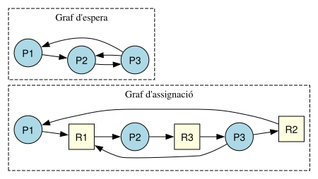
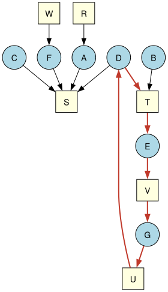
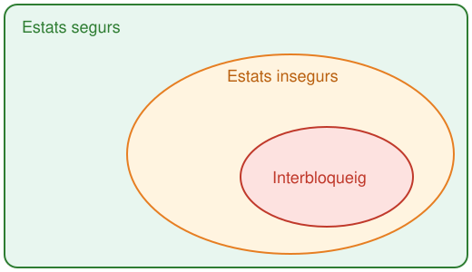

## Objectius de la sessió

::: {.objectius title="En acabar la sessió, has de ser capaç de"}
-   Detectar un interbloqueig amb una instància per recurs (**cicles al graf d'espera**).
-   Aplicar l'**algorisme de detecció** amb diverses instàncies.
-   Triar una estratègia de **recuperació** i justificar-la.
-   Distingir estat **segur**, **insegur** i **interbloqueig**.
-   Aplicar l'**algorisme del banquer** per decidir si es concedeix una petició.
-   Explicar què fan de debò Linux i les bases de dades.
:::

::: {.prerequisits title="Necessites recordar..."}
-   Les quatre condicions i el graf d'assignació de recursos.
-   La diferència entre prevenir i evitar.
:::

# Detecció

## Deixar que passi i trencar-lo

```bash
$ ./locks fcntl                          # el mateix programa, amb fcntl(F_SETLKW)
A: tinc x.dat
B: tinc y.dat
A: demano y.dat
B: demano x.dat
B: x.dat -> Resource deadlock avoided    # EDEADLK
A: tinc x.dat i y.dat
```

-   Amb `fcntl`, el kernel **comprova a cada petició** si bloquejar el procés tancaria un cicle. Si és així, la petició falla amb `EDEADLK`.
-   Amb `flock`, el kernel no comprova res: tots dos processos queden bloquejats per sempre.

## Una instància per recurs: graf d'espera

::::: columns
::: {.column width="45%"}
-   Si cada recurs té una sola instància, n'hi ha prou amb saber **qui espera qui**.
-   **Graf d'espera**: només processos; $P_i \to P_j$ si $P_i$ espera un recurs que té $P_j$.
-   S'obté del graf d'assignació eliminant els recursos.
-   **Hi ha interbloqueig si i només si hi ha un cicle.**
:::

::: {.column width="55%"}
{width="100%"}
:::
:::::


## Trobar cicles: recorregut en profunditat

```text
color[v] = BLANC per a tot v
per a cada v:  si color[v] == BLANC: visita(v)

visita(v):
    color[v] = GRIS                # v és al camí actual
    per a cada aresta v -> w:
        si color[w] == GRIS:  hi ha un CICLE (w ... v -> w)
        si color[w] == BLANC: visita(w)
    color[v] = NEGRE               # tot el que surt de v ja està explorat
```

-   Un **cicle** és una aresta cap a un node que encara és al camí actual (**gris**).
-   Cost: $O(V + E)$, lineal en la mida del graf.


## Exemple

::::: columns
::: {.column width="45%"}
-   A té R i vol S. B vol T. C vol S.
-   D té U i vol S i T.
-   E té T i vol V. F té W i vol S.
-   G té V i vol U.

::: {.reflexio title="Hi ha interbloqueig? Qui hi és?" .fragment}
:::

:::{.solucio .fragment}
Cicle **D → T → E → V → G → U → D**: **D, E i G** estan en interbloqueig.
:::

:::

::: {.column width="55%" .fragment}
{width="45%"}
:::


:::::

## Diverses instàncies: estructures

$n$ processos, $m$ tipus de recurs.

::: nonincremental
| Estructura | Mida | Significat |
|----|------|------------|
| $E$ | $m$ | Instàncies **existents** de cada tipus |
| $A$ | $m$ | Instàncies **disponibles** ara: $A_j = E_j - \sum_i C_{ij}$ |
| $C$ | $n \times m$ | $C_{ij}$: instàncies de $j$ **assignades** a $P_i$ |
| $R$ | $n \times m$ | $R_{ij}$: instàncies de $j$ que $P_i$ **demana ara** (i per les quals espera) |
:::

-   Notació: per a dos vectors, $X \le Y$ si $X_j \le Y_j$ per a **tots** els $j$.

## Algorisme de detecció

```text
W = A                                  # recursos que podríem tenir lliures
cap procés marcat
repeteix:
    busca un Pi no marcat amb R[i] <= W
    si n'hi ha:  W = W + C[i];  marca Pi     # Pi acaba i ho allibera tot
fins que no se'n trobi cap
els processos NO marcats estan en interbloqueig
```

::: {.concepte title="Suposició optimista" .fragment}
Si la petició actual de $P_i$ es pot satisfer, suposem que $P_i$ **acabarà sense demanar res més** i ho alliberarà tot. Si després demana més, ho detectarà la propera execució de l'algorisme.
:::

## Detecció: exemple

$E = (4, 2, 3, 1)$, $A = (2, 1, 0, 0)$

::::: columns
::: {.column width="40%"}
::: nonincremental
| | $C$ | $R$ |
|---|-----|-----|
| P1 | 0 0 1 0 | 2 0 0 1 |
| P2 | 2 0 0 1 | 1 0 1 0 |
| P3 | 0 1 2 0 | 2 1 0 0 |
:::
:::

::: {.column width="60%"}
::: nonincremental
| Pas | $W$ abans | Qui pot? | $W$ després |
|-----|-----------|----------|-------------|
| 1 | 2 1 0 0 | P3 ($R_3 = 2\,1\,0\,0$) | 2 2 2 0 |
| 2 | 2 2 2 0 | P2 ($R_2 = 1\,0\,1\,0$) | 4 2 2 1 |
| 3 | 4 2 2 1 | P1 ($R_1 = 2\,0\,0\,1$) | 4 2 3 1 |
:::
:::
:::::

-   Tots marcats: **no hi ha interbloqueig**. Al final $W = E$ ✓.
-   Si P3 demanés també una unitat del recurs 4, ningú no es podria marcar: **P1, P2 i P3 en interbloqueig**.

## Quan detectar i com recuperar

**Quan s'executa la detecció?**

-   A **cada petició** que no es pot satisfer: es detecta de seguida, però és car (`fcntl` ho fa, amb un algorisme simplificat).
-   **Periòdicament**, o quan la CPU està ociosa molt de temps (molts processos bloquejats).

**Com es trenca?**

-   **Matar processos**: tots els del cicle, o un a un fins que desaparegui. Triar la víctima: prioritat, temps de CPU perdut, recursos que té, si es pot tornar a executar.
-   **Apropiar recursos**: només si el recurs ho permet.
-   **Tornar enrere** (*rollback*): tornar el procés a un punt de control (*checkpoint*) anterior a la petició. Es perd la feina feta des d'aleshores.

# Evitació

## Evitació: estats segurs

-   Idea: abans de concedir un recurs, comprovar que des de l'estat resultant **tots els processos poden acabar** en algun ordre.
-   Requisit: cada procés declara per endavant el **màxim** que pot demanar.

::::: columns
::: {.column width="55%"}
::: {.definicio title="Estat segur" .fragment}
Hi ha una **seqüència segura** $P_{(1)}, P_{(2)}, \dots, P_{(n)}$: el que encara pot demanar cada $P_{(k)}$ es pot satisfer amb els recursos **lliures** més els que tenen **tots** els anteriors $P_{(1)}, \dots, P_{(k-1)}$.
:::
:::

::: {.column width="45%" .fragment}
{width="100%"}
:::
:::::

::: {.errorcomu title="Insegur no vol dir interbloqueig" .fragment}
Un estat insegur és un estat on **no es pot garantir** que tothom acabi. Pot ser que els processos no demanin mai el seu màxim i tot vagi bé.
:::

## Banquer amb un tipus de recurs

10 unitats en total. Cada fila: (té, màxim).

::: nonincremental
| | A | B | C | D | Lliures | Estat |
|---|---|---|---|---|:------:|-------|
| Estat 1 | 1 / 6 | 1 / 5 | 2 / 4 | 4 / 7 | **2** | Segur: C (necessita 2) → B (4) → A (5) → D (3) |
| Estat 2 | 1 / 6 | **2** / 5 | 2 / 4 | 4 / 7 | **1** | **Insegur**: ningú necessita 1 o menys |
:::

-   Si s'està a l'estat 1 i B demana 1 unitat, el banquer **no la concedeix** (aniria a l'estat 2): B espera.
-   Si C demana 1 unitat, sí: queda 1 lliure, C en necessita 1, acaba i n'allibera 4.


## Banquer amb diversos tipus de recurs

$Need = Max - Alloc$ (el que cada procés **encara pot demanar**).

**Algorisme de seguretat** (és segur aquest estat?)

``` text
W = Available;  cap procés acabat
repeteix:
    busca un Pi no acabat amb Need[i] <= W
    si n'hi ha:  W = W + Alloc[i];  Pi acabat
fins que no se'n trobi cap
SEGUR si tots han acabat
```

**Algorisme de petició** ($P_i$ demana $Req$)

1.  Si $Req > Need_i$ → **error**: demana més del màxim que havia declarat.
2.  Si $Req > Available$ → **espera**: no hi ha prou recursos ara.
3.  Simula la concessió: $Available \mathrel{-}= Req$, $Alloc_i \mathrel{+}= Req$, $Need_i \mathrel{-}= Req$. Si l'estat és **segur**, concedeix; si no, desfés la simulació i $P_i$ **espera**.

## Banquer: exemple

Total $(11, 5, 9)$, $Available = (3, 3, 2)$. Convenció: a cada pas, el primer procés (per número) que pot acabar.

::: nonincremental
| | $Max$ | $Alloc$ | $Need$ |
|---|-------|---------|--------|
| P1 | 7 5 3 | 0 1 0 | 7 4 3 |
| P2 | 3 2 2 | 3 0 2 | 0 2 0 |
| P3 | 9 0 2 | 3 0 2 | 6 0 0 |
| P4 | 2 2 2 | 2 1 1 | 0 1 1 |
| P5 | 4 3 3 | 0 0 2 | 4 3 1 |
:::

**P1 demana $(1, 0, 2)$.** $Req \le Need_1 = (7,4,3)$ ✓, $Req \le Available$ ✓. Simulem: $Available = (2, 3, 0)$, $Alloc_1 = (1, 1, 2)$, $Need_1 = (6, 4, 1)$.

::: nonincremental
| Pas | $W$ abans | Qui | $W$ després |
|-----|-----------|-----|-------------|
| 1 | 2 3 0 | P2 ($Need = 0\,2\,0$) | 5 3 2 |
| 2 | 5 3 2 | P4 ($0\,1\,1$) | 7 4 3 |
| 3 | 7 4 3 | P1 ($6\,4\,1$) | 8 5 5 |
| 4 | 8 5 5 | P3 ($6\,0\,0$) | 11 5 7 |
| 5 | 11 5 7 | P5 ($4\,3\,1$) | 11 5 9 |
:::

**Segur → es concedeix.**

## Banquer: petició denegada

Des del mateix estat inicial, **P1 demana $(1, 2, 2)$**.

-   $Req \le Need_1 = (7,4,3)$ ✓; $Req \le Available = (3,3,2)$ ✓.
-   Simulem: $Available = (2, 1, 0)$, $Alloc_1 = (1, 3, 2)$, $Need_1 = (6, 2, 1)$.
-   Algorisme de seguretat amb $W = (2, 1, 0)$:

:::{.fragment}
::: nonincremental
| | P1 | P2 | P3 | P4 | P5 |
|---|----|----|----|----|----|
| $Need$ | 6 2 1 | 0 2 0 | 6 0 0 | 0 1 1 | 4 3 1 |
| $\le (2,1,0)$? | ✗ | ✗ | ✗ | ✗ | ✗ |
:::

**Insegur → no es concedeix**: es desfà la simulació i P1 **espera**, encara que els recursos hi siguin.
:::

## Per què els SO generals no fan servir el banquer

-   Cal saber el **màxim** de cada procés per endavant: un procés real no ho sap.
-   El nombre de processos i de recursos **canvia** contínuament.
-   Cal executar l'algorisme de seguretat ($O(m \cdot n^2)$) a **cada petició**.
-   Deixa recursos sense fer servir per prudència.

::: {.concepte title="On sí que s'utilitza la idea" .fragment}
En sistemes tancats on les necessitats es coneixen: planificadors de treballs (es declara la memòria i les CPU màximes d'un treball), sistemes encastats i de temps real.
:::

# Què fan els sistemes reals

## Linux i les bases de dades

::: nonincremental
| Sistema | Estratègia | Com |
|---------|-----------|-------------------------------|
| Kernel de Linux (els seus locks) | **Prevenció** | Ordre de locks documentat; `lockdep` el comprova als kernels de depuració |
| Kernel de Linux (processos penjats) | **Detecció** heurística | El *hung task detector* avisa si un procés porta més de 120 s bloquejat sense poder ser interromput |
| `fcntl` (bloquejos de fitxer) | **Detecció** a cada petició | Retorna `EDEADLK` |
| `flock` | **Estruç** | No comprova res |
| Bases de dades | **Detecció i recuperació** | Graf d'espera entre transaccions; avorten una víctima i en desfan els canvis |
| Bases de dades (alternativa) | **Prevenció** | *Wait-die* / *wound-wait*: per edat; només els vells esperen els joves (o al revés) |
:::

## Diagnosticar un interbloqueig a Linux

``` bash
ps -o pid,stat,wchan:22,cmd -u $USER    # qui està adormit (S, D) i on
cat /proc/locks                         # bloquejos de fitxer actius
lslocks                                 # el mateix, llegible: qui té què
sudo cat /proc/<pid>/stack              # pila del kernel d'un procés
```

-   A l'exemple de `./locks flock`: `lslocks` mostra que un procés té `x.dat` i un altre `y.dat`, i `ps` mostra tots dos a `locks_lock_inode_wait`.
-   Amb aquesta informació es pot dibuixar el graf d'assignació a mà.


## Resum

::: {.resum}
-   **Detecció** amb una instància: cicle al **graf d'espera** (DFS, $O(V+E)$).
-   **Detecció** amb diverses instàncies: marcar processos amb $R_i \le W$, $W \mathrel{+}= C_i$. Els no marcats estan en interbloqueig.
-   **Recuperació**: matar (triant la víctima), apropiar, tornar enrere.
-   **Evitació**: només es concedeix si l'estat resultant és **segur**. Banquer: el mateix algorisme amb $Need = Max - Alloc$.
-   Insegur ≠ interbloqueig. Detecció: petició **actual**; banquer: **màxim** pendent.
-   A la pràctica: prevenció per ordre (kernel), detecció (`fcntl`, bases de dades), estruç (aplicacions).
:::
