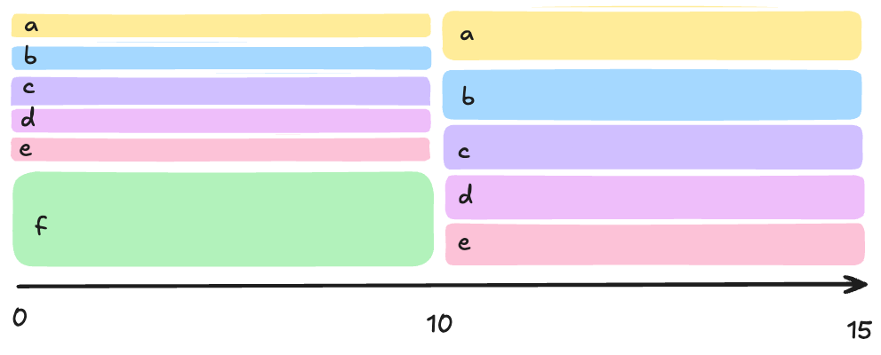
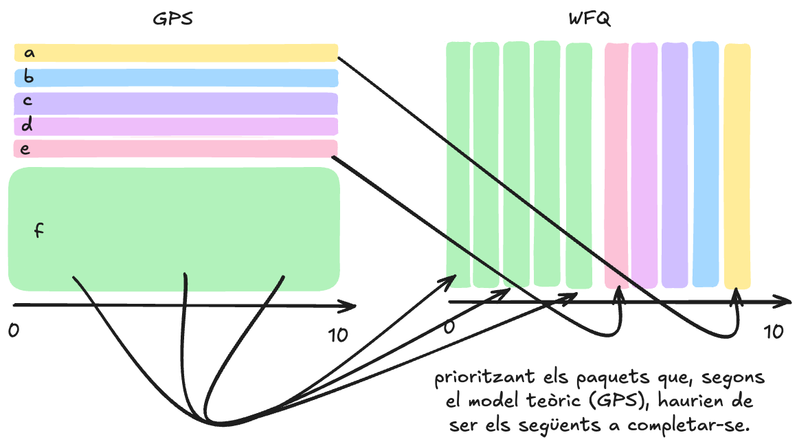
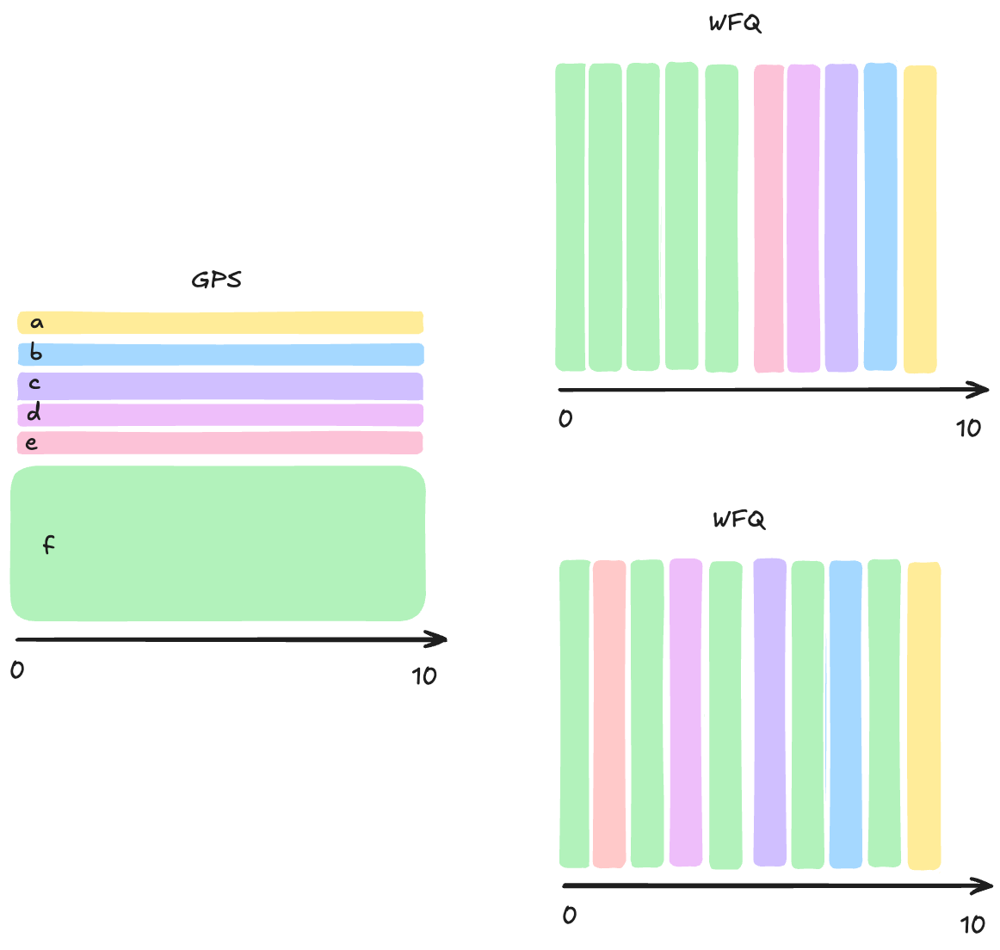

## Objectius de la sessió

::: {.objectius title="En acabar la sessió, has de ser capaç de"}
-   Definir amb precisió què vol dir que un planificador sigui **just**.
-   Calcular repartiments **max-min** (simples i amb pesos).
-   Explicar la planificació per **loteria** i per **stride**, i per què la segona és determinista.
-   Descriure el model ideal **GPS** i el **temps virtual** $V(t)$.
-   Aplicar **WFQ** i **WF²Q** i calcular el **lag** respecte del model ideal.
:::

::: {.prerequisits title="Necessites recordar"}
-   Inanició, envelliment i MLFQ.
-   Mètriques de planificació i Round Robin.
:::


## On érem

-   La justícia era **una correcció a posteriori**: l'envelliment i el *boost* eviten la inanició amb heurístiques i paràmetres arbitraris.
-   Avui canviem la pregunta: en lloc de quin procés va primer?, **quina fracció de CPU li pertoca a cada procés?**
-   Si sabem quina fracció li pertoca a cada un, podem **mesurar** com de lluny n'està el planificador.

::: {.concepte title="Repartiment proporcional (proportional share)" .fragment}
Cada procés $i$ té un **pes** $w_i$. Mentre està actiu, li pertoca una fracció de CPU

$$f_i(t) = \frac{w_i}{\sum_{j \in A(t)} w_j}$$

on $A(t)$ és el conjunt de processos **actius** (preparats o en execució) a l'instant $t$.
:::

## Què és ser just?

-   **Igualtat de servei**: dos processos amb el mateix pes reben la mateixa CPU.
-   **Proporcionalitat**: amb pesos diferents, la CPU es reparteix segons els pesos.
-   **Conservació de la feina** (*work-conserving*): la CPU no queda mai ociosa si hi ha feina. És una propietat d'**eficiència**, no de justícia, però un planificador just que no la compleix malbarata recursos.

::: {.errorcomu title="Just no vol dir òptim" .fragment}
FCFS no provoca inanició i, en canvi, no és just en aquest sentit: un procés llarg pot rebre el 100 % de la CPU durant molt de temps. I SRTF, que és òptim en retorn mitjà, és clarament injust.
:::

# Max-min fairness

## Què fem si algú no necessita la seva part?

Capacitat $C = 10$. Quant rep cada procés?

::: nonincremental
| Cas | Demandes | Repartiment just |
|-----|----------|------------------|
| 1 | P1 = 8, P2 = 6 | ? |
| 2 | P1 = 8, P2 = 4 | ? |
| 3 | P1 = 8, P2 = 4, P3 = 2 | ? |
:::

::: fragment
::: nonincremental
| Cas | Repartiment | Per què |
|-----|-------------|---------|
| 1 | 5, 5 | Tots dos volen més que la meitat: meitat i meitat. |
| 2 | 6, 4 | P2 només en vol 4; el que sobra de la seva meitat va a P1. |
| 3 | 4, 4, 2 | P3 en vol 2 < 10/3; queden 8 per a dos: 4 i 4. |
:::
:::

## Max-min fairness: definició

::: {.definicio title="Repartiment max-min just"}
Un repartiment és **max-min just** si no es pot augmentar la part de cap procés sense reduir la d'un altre que en tingui **menys o igual**.
:::

**Com es calcula** (*progressive filling*):

1.  Reparteix la capacitat que queda a parts iguals entre els processos no satisfets.
2.  Els processos que demanen **menys o igual** que la seva part en reben exactament la demanda i surten.
3.  Si n'ha sortit algun, torna al pas 1 amb la capacitat sobrant. Si no, tots reben la part i s'acaba.

-   Ningú rep més del que demana.
-   El que un procés no fa servir es reparteix entre els altres.

## Max-min amb pesos

En el pas 1, la capacitat es reparteix **proporcionalment als pesos** dels no satisfets.

::: {.exemple title="C = 12, demandes 8, 6, 2 i pesos 1, 2, 1"}
::: nonincremental
| Ronda | Per unitat de pes | P1 (w=1) | P2 (w=2) | P3 (w=1) | Qui surt |
|-------|-------------------|----------|----------|----------|----------|
| 1 | 12/4 = 3 | 3 | 6 | 3 | P3 (vol 2) i P2 (vol 6) |
| 2 | 4/1 = 4 | **4** | 6 | 2 | P1 rep el que queda |
:::

Resultat: **4, 6, 2**.
:::

# Loteria i stride

## Planificació per loteria

-   Cada procés té un nombre de **bitllets** (Waldspurger i Weihl, 1994).
-   A cada quantum se sorteja un bitllet; s'executa el propietari.
-   **En esperança**, la fracció de CPU d'un procés és $\dfrac{\text{bitllets}_i}{\sum \text{bitllets}}$.

::: {.exemple title="Curts: 10 bitllets cadascun · llargs: 1 bitllet cadascun" .fragment}
::: nonincremental
| Curts | Llargs | CPU de **cada** curt | CPU de **cada** llarg |
|:-----:|:------:|:-----:|:-----:|
| 1 | 1 | 90.9 % | 9.1 % |
| 0 | 2 | – | 50 % |
| 2 | 0 | 50 % | – |
| 10 | 1 | 9.9 % | 1.0 % |
| 1 | 10 | 50 % | 5 % |
:::
:::

-   Amb molts curts, **els llargs reben molt poca CPU**, però mai zero: no hi ha inanició, només una part petita.

## Loteria: justa només en esperança

::: {.reflexio title="Dos processos amb els mateixos bitllets, 100 quanta"}
En esperança, cadascun rep 50 quanta. Quina probabilitat hi ha que un d'ells en rebi 60 o més?
:::

::: fragment
-   El nombre de quanta guanyats segueix una binomial $B(100, 0.5)$: desviació típica $= \sqrt{100\cdot0.5\cdot0.5} = 5$.
-   $P(X \geq 60) \approx 2.8\,\%$. En intervals curts, el repartiment pot ser força injust.
-   La desviació relativa disminueix com $1/\sqrt{n}$: la loteria només és justa **a la llarga**.
:::

## Avantatges de la loteria

-   **Sense estat global**: no cal recordar quant ha rebut cada procés; un procés nou s'integra immediatament.
-   **Transferència de bitllets**: un client que espera un servidor li pot cedir els seus bitllets mentre espera.
-   **Inflació** i **monedes locals**: un usuari pot repartir els seus bitllets entre els seus processos sense afectar els altres usuaris.

::: {.concepte title="El problema" .fragment}
L'aleatorietat fa que la justícia sigui només probabilística. Podem obtenir el mateix repartiment **de manera determinista**?
:::


## Planificació per stride

Waldspurger, 1995: la versió determinista de la loteria.

-   Cada procés té un **stride** $= L / \text{bitllets}_i$ ($L$ és una constant gran).
-   Cada procés té un comptador **pass**, inicialment 0.
-   A cada quantum: s'executa el procés amb el **pass mínim** i se li suma el seu stride.

```{.c .fragment}
p = proces_amb_pass_minim(cua);
executa(p, quantum);
p->pass += p->stride;
```

-   Com més bitllets, més petit és l'stride: el *pass* creix més a poc a poc i el procés torna a ser el mínim més sovint.


## Stride: exemple

A: 100 bitllets · B: 50 · C: 250 · $L = 10000$ → strides 100, 200, 40. Empats per ordre alfabètic.

::: nonincremental
| Quantum | Pass A | Pass B | Pass C | S'executa |
|:-------:|:------:|:------:|:------:|:---------:|
| 1 | 0 | 0 | 0 | A |
| 2 | 100 | 0 | 0 | B |
| 3 | 100 | 200 | 0 | C |
| 4 | 100 | 200 | 40 | C |
| 5 | 100 | 200 | 80 | C |
| 6 | 100 | 200 | 120 | A |
| 7 | 200 | 200 | 120 | C |
| 8 | 200 | 200 | 160 | C |
| 9 | 200 | 200 | 200 | A |
:::

-   Després de 8 quanta, A n'ha rebut 2, B 1 i C 5: exactament **100 : 50 : 250**.

## Stride: on és el problema?

::: {.reflexio title="Arriba un procés nou D a l'instant 9"}
Si D comença amb *pass* = 0, què passa?
:::

::: fragment
-   D té el *pass* mínim amb molta diferència i **monopolitza la CPU** fins que el seu *pass* arriba a 200.
-  un procés nou (o que torna d'un bloqueig) comença amb el **pass mínim dels actius**, no amb 0.
-   Aquest *pass* és el **`vruntime`** de CFS, i el *pass* mínim és el seu `min_vruntime`.
:::

# Del model ideal als algorismes reals

## El model ideal: GPS

**Generalized Processor Sharing** (Parekh i Gallager, 1993): el recurs es reparteix com un **fluid**. Tots els actius reben servei **alhora**, cadascun a ritme $f_i(t) \cdot C$.

::::: columns
::: {.column width="40%"}
::: nonincremental
| Flux | Pes | Ritme |
|:----:|:---:|:-----:|
| f | 5 | 50 % |
| a–e | 1 cadascun | 10 % cadascun |
:::

-   Enllaç d'1 paquet per unitat de temps.
-   f té 5 paquets; a–e, 1 paquet cadascun.
-   Tots arriben a $t = 0$.
:::

::: {.column width="60%"}
{width="95%"}
:::
:::::

## Per què no es pot implementar GPS?

-   Una CPU (o un enllaç) només pot servir **un** procés (o paquet) alhora.
-   GPS és la **referència**: un algorisme real és més just com més a prop es manté de GPS.
-   La distància es mesura amb el **lag**:

:::{.fragment}
$$
\operatorname{lag}_i(t)
=
\underbrace{S_i^{\mathrm{GPS}}(t)}_{\text{servei ideal}}
-
\underbrace{s_i(t)}_{\text{servei real}}
$$
:::

-   $\text{lag} > 0$: el procés ha rebut **menys** del que li toca (se li deu servei).
-   $\text{lag} < 0$: el procés ha rebut **més** del que li toca.

::: {.errorcomu title="El signe del lag" .fragment}
Alguns textos de xarxes el defineixen amb el signe contrari. En aquest curs fem servir el conveni del **kernel de Linux**: lag positiu = se li deu servei.
:::


## Temps virtual

El temps real no serveix per calcular quan acabaria un paquet a GPS: depèn de quants fluxos arribaran o marxaran. Fem servir un **temps virtual** $V(t)$ que avança al ritme del servei que rep **un flux de pes 1**:

$$\frac{dV}{dt} = \frac{C}{\sum_{j \in A(t)} w_j}$$

-   Si hi ha més fluxos actius, $V$ avança **més a poc a poc**: cada un rep menys.
-   Un paquet de mida $L$ d'un flux de pes $w$ necessita $L / w$ unitats de **temps virtual**, independentment de qui més hi hagi.
-   A l'exemple: $\sum w = 10$, per tant $V(t) = t / 10$.


## WFQ: Weighted Fair Queuing

Demers, Keshav i Shenker (1989). Per a cada paquet $k$ del flux $i$, que arriba a l'instant real $a_i^k$:

$$S_i^k = \max\!\left(F_i^{k-1},\ V(a_i^k)\right) \qquad F_i^k = S_i^k + \frac{L_i^k}{w_i}$$

-   $S_i^k$ (*start tag*): instant virtual en què el paquet **començaria** a GPS.
-   $F_i^k$ (*finish tag*): instant virtual en què **acabaria** a GPS.
-   **WFQ** envia sempre el paquet amb el **$F$ mínim**.

{width="60%"}


## WFQ s'avança massa a GPS

Tags de l'exemple (pes f = 5, a–e = 1):

::: nonincremental
| Paquet | f1 | f2 | f3 | f4 | f5 | a–e |
|--------|----|----|----|----|----|-----|
| $S$ | 0 | 0.2 | 0.4 | 0.6 | 0.8 | 0 |
| $F$ | 0.2 | 0.4 | 0.6 | 0.8 | 1.0 | 1.0 |
:::

-   WFQ envia **f f f f f** i després a–e (empat a $F = 1.0$ resolt a favor de f).
-   A $t = 5$, f ha enviat 5 paquets; a GPS n'hauria enviat 2.5. **lag(f) = −2.5**.
-   f ha rebut una ràfega, i a–e, que a GPS haurien progressat des de $t=0$, no han rebut res.
-   Amb $N$ fluxos petits, aquest avançament creix amb $N$.

## WF²Q: només els elegibles

Bennett i Zhang (1996): un paquet és **elegible** si a GPS **ja hauria començat**:

$$S_i^k \leq V(t)$$

**WF²Q** envia, d'entre els paquets **elegibles**, el de **$F$ mínim**.

::: nonincremental
| $t$ | 0 | 1 | 2 | 3 | 4 | 5 | 6 | 7 | 8 | 9 |
|-----|---|---|---|---|---|---|---|---|---|---|
| $V(t)$ | 0 | 0.1 | 0.2 | 0.3 | 0.4 | 0.5 | 0.6 | 0.7 | 0.8 | 0.9 |
| WFQ | f | f | f | f | f | e | d | c | b | a |
| WF²Q | f | e | f | d | f | c | f | b | f | a |
:::

-   A $t=1$, f2 té $S = 0.2 > V = 0.1$: **no és elegible**, encara que tingui el $F$ més petit.
-   Amb WF²Q, el lag de f és com a màxim **−0.5** paquets. En general, WF²Q no s'avança mai més d'un paquet a GPS.


## Les dues planificacions

{width="65%"}


## Resum

::: {.resum }
-   Justícia = **repartiment proporcional** als pesos entre els processos **actius**.
-   **Max-min**: ningú rep més del que demana; el sobrant es redistribueix.
-   **Loteria**: proporcional en esperança, però amb variància. **Stride**: la versió determinista; el *pass* és un temps virtual.
-   **GPS** és el model ideal; el **lag** mesura la distància respecte d'ell.
-   **WFQ** envia el $F$ mínim i pot avançar-se molt a GPS. **WF²Q** hi afegeix l'**elegibilitat** ($S \le V$) i acota el lag.
:::

