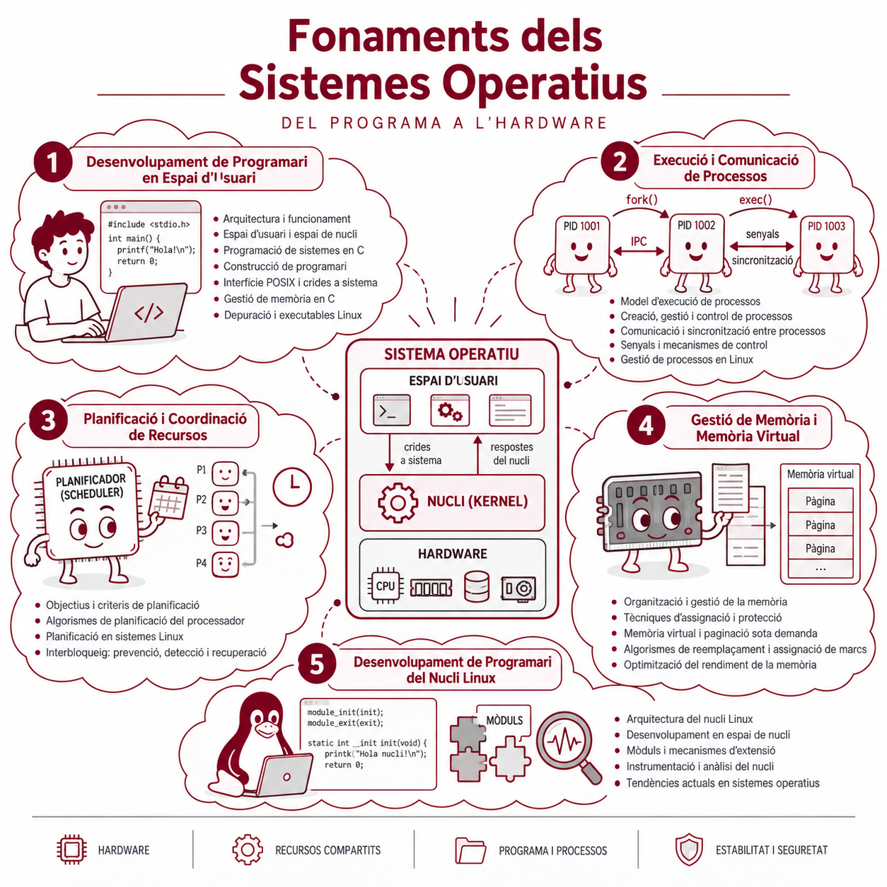

```{=html}
<div class="udl-hero">
  <div>
    <div class="udl-hero-eyebrow">Universitat de Lleida · Curs 2026-27 · Materials Oberts</div>
    <h2>Materials de Sistemes Operatius</h2>
    <p>Funcionament intern dels sistemes operatius amb Linux com a plataforma de referència: des de l'espai de memòria i les crides a sistema en C fins a la gestió de processos, comunicació (IPC) i planificació de la CPU.</p>
    <div style="display:flex; gap:0.65rem; flex-wrap:wrap; margin-top:1rem;">
      <a href="course-info/presentation-slides.html?vista=apunts" class="udl-button">Presentació del curs</a>
      <a href="course-info/guia-estudi.html" class="udl-button udl-hero-btn-ghost">Guia d'estudi i resums</a>
      <a href="course-info/entrenament-interactiu.html" class="udl-button udl-hero-btn-ghost">Laboratori interactiu</a>
    </div>
  </div>
</div>
```

{data-udl-no-card="true" fig-alt="Il·lustració dels conceptes clau d'un sistema operatiu: CPU, memòria RAM, processos i maquinari, ordenats en tres blocs de temari."}

## Cerca ràpida de conceptes i materials

```{=html}
<div class="udl-widget" style="border-left: 4px solid var(--udl-outcome); margin-top: 1rem;">
  <div style="margin-bottom:0.85rem;">
    <label for="idx-quick-find" style="display:block; font-weight:700; font-size:0.92rem; color:var(--udl-primary-dark); margin-bottom:0.4rem;">
      Troba directament qualsevol concepte, funció de C/POSIX o pràctica
    </label>
    <input type="search" id="idx-quick-find" placeholder="Escriu per exemple: fork, dup2, pipe, malloc, stack, char**, zombie, senyals, minishell, Round Robin..." style="width:100%; box-sizing:border-box; padding:0.6rem 0.9rem; border-radius:8px; border:1px solid var(--udl-border); background:var(--udl-surface-sunken); color:var(--udl-text); font-size:0.9rem;">
  </div>

  <div style="display:flex; flex-wrap:wrap; gap:0.38rem;" id="idx-quick-chips">
    <span style="font-size:0.76rem; color:var(--udl-text-muted); align-self:center; margin-right:0.2rem;">Temes freqüents:</span>
    <button type="button" data-q="stack heap" class="udl-badge udl-badge-neutral" style="border:1px solid var(--udl-border); cursor:pointer;">Stack vs Heap</button>
    <button type="button" data-q="punter" class="udl-badge udl-badge-neutral" style="border:1px solid var(--udl-border); cursor:pointer;">Punters i char**</button>
    <button type="button" data-q="fork" class="udl-badge udl-badge-neutral" style="border:1px solid var(--udl-border); cursor:pointer;">fork / wait / exec</button>
    <button type="button" data-q="pipe dup2" class="udl-badge udl-badge-neutral" style="border:1px solid var(--udl-border); cursor:pointer;">pipe i dup2</button>
    <button type="button" data-q="minishell" class="udl-badge udl-badge-neutral" style="border:1px solid var(--udl-border); cursor:pointer;">Minishell</button>
    <button type="button" data-q="planificacio" class="udl-badge udl-badge-neutral" style="border:1px solid var(--udl-border); cursor:pointer;">Gantt i RR</button>
  </div>

  <div id="idx-quick-results" style="display:none; max-height:340px; overflow-y:auto; border-top:1px solid var(--udl-border); margin-top:0.85rem; padding-top:0.6rem;"></div>
</div>

<script>
(function() {
  const catalog = [
    { t: "Guia d'estudi, taules resum i plantilla DIN A4", u: "course-info/guia-estudi.html", k: "resum examen a4 flashcards formules dubtes", b: "Resums", c: "udl-badge-exam", slide: false },
    { t: "Laboratori interactiu: Mapa RAM, Simulador fork(), Caçador d'errors i Planificació CPU", u: "course-info/entrenament-interactiu.html", k: "practica interactiva stack heap rodata bss fork zombie deadlock bug errors sched fcfs sjf round robin", b: "Interactiu", c: "udl-badge-lab", slide: false },
    { t: "Bloc 1 · Teoria 01: Rols i funcions d'un sistema operatiu", u: "blocs/01-espai-usuari/teoria/01_rols_funcions.html", k: "kernel espai usuari abstraccio multiplexacio aillament", b: "Teoria B1", c: "udl-badge-theory", slide: true },
    { t: "Bloc 1 · Teoria 02: L'espai de memòria d'un procés", u: "blocs/01-espai-usuari/teoria/02_espai_memoria_proces.html", k: "memoria virtual stack heap data bss rodata text adreces", b: "Teoria B1", c: "udl-badge-theory", slide: true },
    { t: "Bloc 1 · Teoria 03: Crides de funció: CPU, registres i stack", u: "blocs/01-espai-usuari/teoria/03_crides_funcions_cpu_registres_stack.html", k: "stack frame pila rbp rsp rip call ret registres", b: "Teoria B1", c: "udl-badge-theory", slide: true },
    { t: "Bloc 1 · Teoria 04: Com es construeix un programa C?", u: "blocs/01-espai-usuari/teoria/04_construccio_progama_c.html", k: "gcc compilacio preprocessador linker elf llibreries header makefile", b: "Teoria B1", c: "udl-badge-theory", slide: true },
    { t: "Bloc 1 · Teoria 05: De variables a estructures de dades", u: "blocs/01-espai-usuari/teoria/05_variables_estructures.html", k: "struct llista enllacada punter sizeof padding", b: "Teoria B1", c: "udl-badge-theory", slide: true },
    { t: "Bloc 1 · Teoria 06: System calls: del programa C al kernel", u: "blocs/01-espai-usuari/teoria/06_syscalls_del_c_al_kernel.html", k: "syscall libc api abi ring 0 ring 3 write read open close errno", b: "Teoria B1", c: "udl-badge-theory", slide: true },
    { t: "Bloc 1 · Teoria 07: System calls: dins del kernel", u: "blocs/01-espai-usuari/teoria/07_syscalls_kernel.html", k: "kernel pt_regs efault copy_from_user page fault", b: "Teoria B1", c: "udl-badge-theory", slide: true },
    { t: "Pralab 01: Del C a la memòria (I) — Adreces i mides", u: "blocs/01-espai-usuari/pralabs/01_c_mem.html", k: "pralab memoria sizeof adreces punter stack", b: "Pralab B1", c: "udl-badge-lab", slide: false },
    { t: "Pralab 02: Del v[i] al punter — Aritmètica de punters", u: "blocs/01-espai-usuari/pralabs/02_c_mem.html", k: "pralab punter array aritmetica cadenes char", b: "Pralab B1", c: "udl-badge-lab", slide: false },
    { t: "Pralab 03: Memòria dinàmica (I) — malloc, free i lifetime", u: "blocs/01-espai-usuari/pralabs/03_c_heap.html", k: "pralab heap malloc free realloc memory leak dangling", b: "Pralab B1", c: "udl-badge-lab", slide: false },
    { t: "Pralab 04: Memòria dinàmica (II) — Punters a punters (char **)", u: "blocs/01-espai-usuari/pralabs/04_c_ptrptr.html", k: "pralab doble punter char** argv matriu", b: "Pralab B1", c: "udl-badge-lab", slide: false },
    { t: "Activitat B1: Exercicis bàsics · Rols i funcions del SO", u: "blocs/01-espai-usuari/activitats/01_rols_funcions.html", k: "exercicis rols funcions arbitre ilusionista pega kernel", b: "Activitat B1", c: "udl-badge-assignment", slide: false },
    { t: "Activitat B1: Exercicis bàsics · Espai de memòria i crides", u: "blocs/01-espai-usuari/activitats/02_espai_funcions.html", k: "exercicis espai memoria stack frame registres gdb", b: "Activitat B1", c: "udl-badge-assignment", slide: false },
    { t: "Activitat B1: Exercicis amb C · Apuntadors i arrays", u: "blocs/01-espai-usuari/activitats/01_c_punters_arrays.html", k: "exercicis punter array sizeof cadenes", b: "Activitat B1", c: "udl-badge-assignment", slide: false },
    { t: "Activitat B1: Exercicis amb C · Pokémon (structs i Heap)", u: "blocs/01-espai-usuari/activitats/03_pokemon.html", k: "pokemon struct malloc free punters", b: "Activitat B1", c: "udl-badge-assignment", slide: false },
    { t: "Bloc 2 · Teoria 01: Processos: concepte, estats i PCB", u: "blocs/02-proc/teoria/01-procs.html", k: "proces pcb pid ppid estats running ready blocked", b: "Teoria B2", c: "udl-badge-theory", slide: true },
    { t: "Bloc 2 · Teoria 02: Creació de processos (fork, wait, exec)", u: "blocs/02-proc/teoria/02-create.html", k: "fork wait waitpid wexitstatus exec execvp zombie orfe cow", b: "Teoria B2", c: "udl-badge-theory", slide: true },
    { t: "Bloc 2 · Teoria 03: Senyals (kill, sigaction, SIGCHLD)", u: "blocs/02-proc/teoria/03-signals.html", k: "senyals signals sigint sigkill sigchld sigaction kill pause", b: "Teoria B2", c: "udl-badge-theory", slide: true },
    { t: "Bloc 2 · Teoria 04: Pipes i redirecció d'E/S (pipe, dup2)", u: "blocs/02-proc/teoria/04-pipes.html", k: "pipe dup dup2 redireccio descriptors fd stdin stdout eof", b: "Teoria B2", c: "udl-badge-theory", slide: true },
    { t: "Bloc 2 · Teoria 05: Pipes amb nom (FIFOs / mkfifo)", u: "blocs/02-proc/teoria/05-fifos.html", k: "fifo mkfifo canonada amb nom ipc", b: "Teoria B2", c: "udl-badge-theory", slide: true },
    { t: "Pralab 05 (I): Minishell — getline, fork, wait i execvp", u: "blocs/02-proc/pralabs/01_minishell.html", k: "minishell shell getline fork wait execvp", b: "Pralab B2", c: "udl-badge-lab", slide: false },
    { t: "Pralab 05 (II): Minishell — strtok, múltiples comandes (;) i senyals", u: "blocs/02-proc/pralabs/02_minishell.html", k: "minishell shell strtok sigint sigaction senyals", b: "Pralab B2", c: "udl-badge-lab", slide: false },
    { t: "Pralab 05 (III): Minishell — Redireccions (<, >, >>) amb open i dup2", u: "blocs/02-proc/pralabs/03_minishell.html", k: "minishell shell redireccio open dup2 o_creat o_trunc o_append", b: "Pralab B2", c: "udl-badge-lab", slide: false },
    { t: "Activitat B2: Problemes de classe · fork() i wait()", u: "blocs/02-proc/activitats/01-fork-wait.html", k: "arbre fork wait wexitstatus pid", b: "Activitat B2", c: "udl-badge-assignment", slide: false },
    { t: "Activitat B2: Exercicis de creació de processos en C", u: "blocs/02-proc/activitats/02-create.html", k: "fork waitpid jerarquia processos", b: "Activitat B2", c: "udl-badge-assignment", slide: false },
    { t: "Activitat B2: Zombis, orfes i família exec()", u: "blocs/02-proc/activitats/03-exec.html", k: "zombie orfe execvp execlp", b: "Activitat B2", c: "udl-badge-assignment", slide: false },
    { t: "Activitat B2: Exercicis de Pipes, FIFOs i dup2 en C", u: "blocs/02-proc/activitats/04-pipes.html", k: "pipe dup2 mkfifo fifo descriptors ls wc", b: "Activitat B2", c: "udl-badge-assignment", slide: false },
    { t: "Activitat B2: Generador de bitllets de loteria (integrador)", u: "blocs/02-proc/activitats/05-loteria.html", k: "loteria integrador fork pipe senyals", b: "Activitat B2", c: "udl-badge-assignment", slide: false },
    { t: "Bloc 3 · Teoria 01: Planificació de processos", u: "blocs/03-sched/teoria/01-sched.html", k: "planificacio cpu fcfs sjf srtf round robin quantum retorn espera resposta comboi", b: "Teoria B3", c: "udl-badge-theory", slide: true },
    { t: "Activitat B3: Simulador de Gantt i exercicis resolts de planificació", u: "blocs/03-sched/activitats/01-sched-activitats.html", k: "planificacio simulador gantt fcfs sjf srtf round robin quantum exercicis", b: "Activitat B3", c: "udl-badge-assignment", slide: false }
  ];

  const inp = document.getElementById('idx-quick-find');
  const res = document.getElementById('idx-quick-results');
  const chips = document.querySelectorAll('#idx-quick-chips button[data-q]');

  function norm(s) {
    return (s || '').toLowerCase().normalize('NFD').replace(/[\u0300-\u036f]/g, '');
  }

  function search() {
    const raw = norm(inp.value).trim();
    if (!raw) {
      res.style.display = 'none';
      res.innerHTML = '';
      return;
    }
    const terms = raw.split(/\s+/);
    const hits = catalog.filter(item => {
      const hay = norm(item.t + ' ' + item.k);
      return terms.some(term => hay.indexOf(term) !== -1);
    }).sort((a, b) => {
      const ha = norm(a.t + ' ' + a.k);
      const hb = norm(b.t + ' ' + b.k);
      const sa = terms.filter(t => ha.indexOf(t) !== -1).length;
      const sb = terms.filter(t => hb.indexOf(t) !== -1).length;
      return sb - sa;
    });

    res.style.display = 'block';
    if (hits.length === 0) {
      res.innerHTML = '<div style="font-size:0.85rem; color:var(--udl-text-muted); padding:0.3rem 0;">Cap coincidència directa. Utilitza la icona de lupa de la barra superior per cercar dins del text complet de totes les pàgines.</div>';
      return;
    }
    res.innerHTML = hits.map(h => {
      const links = h.slide
        ? `<div style="display:flex; gap:0.35rem; align-items:center; flex-wrap:wrap;">
             <a href="${h.u}?vista=apunts" class="udl-badge udl-badge-theory" style="text-decoration:none;">Format apunts</a>
             <a href="${h.u}?vista=diapos" class="udl-badge udl-badge-neutral" style="text-decoration:none;">Diapos</a>
           </div>`
        : `<span class="udl-badge ${h.c}" style="white-space:nowrap;">${h.b}</span>`;
      return `
        <div class="udl-list-row" style="align-items:center;">
          <a href="${h.slide ? (h.u + '?vista=apunts') : h.u}" style="font-weight:600; text-decoration:none;">${h.t}</a>
          ${links}
        </div>
      `;
    }).join('');
  }

  inp.addEventListener('input', search);
  chips.forEach(btn => {
    btn.addEventListener('click', () => {
      inp.value = btn.dataset.q;
      search();
      inp.focus();
    });
  });
})();
</script>
```

## Continguts per blocs

```{=html}
<div class="udl-card-grid">
  <div class="udl-card udl-card-lecture">
    <div>
      <div class="udl-card-eyebrow" style="color:var(--udl-theory);">Bloc 1 · Espai d'Usuari</div>
      <h3>Programació en C, Memòria i Syscalls</h3>
      <p>Arquitectura del SO, mapa de memòria d'un procés (Stack, Heap, Data, Text), punters, construcció d'executables ELF i pas a mode kernel via <code>syscall</code>.</p>
    </div>
    <div style="margin-top:0.9rem; display:flex; flex-wrap:wrap; gap:0.38rem;">
      <a href="blocs/01-espai-usuari/teoria/01_rols_funcions.html?vista=apunts" class="udl-badge udl-badge-theory" style="text-decoration:none;">Apunts (7)</a>
      <a href="blocs/01-espai-usuari/teoria/01_rols_funcions.html?vista=diapos" class="udl-badge udl-badge-neutral" style="text-decoration:none;">Diapos</a>
      <a href="blocs/01-espai-usuari/pralabs/01_c_mem.html" class="udl-badge udl-badge-lab" style="text-decoration:none;">Pralabs (4)</a>
      <a href="blocs/01-espai-usuari/activitats/01_c_punters_arrays.html" class="udl-badge udl-badge-assignment" style="text-decoration:none;">Activitats (4)</a>
    </div>
  </div>

  <div class="udl-card udl-card-lab">
    <div>
      <div class="udl-card-eyebrow" style="color:var(--udl-lab);">Bloc 2 · Processos</div>
      <h3>Execució, Senyals, Pipes i Minishell</h3>
      <p>Model de processos a Linux, creació i control (<code>fork</code>, <code>waitpid</code>, <code>exec</code>), senyals amb <code>sigaction</code>, canonades (<code>pipe</code>, <code>dup2</code>, FIFOs) i implementació d'una <em>minishell</em>.</p>
    </div>
    <div style="margin-top:0.9rem; display:flex; flex-wrap:wrap; gap:0.38rem;">
      <a href="blocs/02-proc/teoria/01-procs.html?vista=apunts" class="udl-badge udl-badge-theory" style="text-decoration:none;">Apunts (5)</a>
      <a href="blocs/02-proc/teoria/01-procs.html?vista=diapos" class="udl-badge udl-badge-neutral" style="text-decoration:none;">Diapos</a>
      <a href="blocs/02-proc/pralabs/01_minishell.html" class="udl-badge udl-badge-lab" style="text-decoration:none;">Minishell (3)</a>
      <a href="blocs/02-proc/activitats/01-fork-wait.html" class="udl-badge udl-badge-assignment" style="text-decoration:none;">Activitats (5)</a>
    </div>
  </div>

  <div class="udl-card udl-card-assignment">
    <div>
      <div class="udl-card-eyebrow" style="color:var(--udl-assignment);">Bloc 3 · Planificació</div>
      <h3>Planificació del Processador</h3>
      <p>Criteris i mètriques (<i>T</i><sub>retorn</sub>, <i>T</i><sub>espera</sub>, <i>T</i><sub>resposta</sub>, <i>T</i><sub>N</sub>), polítiques apropiatives i no apropiatives (FCFS, SJF, SRTF, Round Robin), efecte comboi i canvi de context.</p>
    </div>
    <div style="margin-top:0.9rem; display:flex; flex-wrap:wrap; gap:0.38rem;">
      <a href="blocs/03-sched/teoria/01-sched.html?vista=apunts" class="udl-badge udl-badge-theory" style="text-decoration:none;">Apunts</a>
      <a href="blocs/03-sched/teoria/01-sched.html?vista=diapos" class="udl-badge udl-badge-neutral" style="text-decoration:none;">Diapos</a>
      <a href="blocs/03-sched/activitats/01-sched-activitats.html" class="udl-badge udl-badge-assignment" style="text-decoration:none;">Activitats i Simulador</a>
    </div>
  </div>
</div>
```

## Itinerari d'estudi pas a pas

```{=html}
<div class="udl-widget" id="udl-roadmap" style="border-left: 4px solid var(--udl-theory);">
  <div style="margin-bottom:0.85rem; padding-bottom:0.75rem; border-bottom:1px solid var(--udl-border); display:flex; flex-wrap:wrap; justify-content:space-between; align-items:center; gap:0.65rem;">
    <div style="font-size:0.85rem; color:var(--udl-text);">
      <strong>Com abordar l'assignatura amb una base sòlida:</strong> segueix l'ordre recomanat de cada bloc (<em>Teoria en vista d'apunts → Laboratori guiat → Pràctica → Verificació</em>) o comença per la <a href="course-info/guia-estudi.html#visio-global" style="font-weight:700;">Visió global i els 6 pilars fonamentals</a>.
    </div>
  </div>
  <div style="display:flex; flex-wrap:wrap; justify-content:space-between; align-items:center; gap:0.65rem; margin-bottom:0.75rem;">
    <div style="display:flex; flex-wrap:wrap; gap:0.4rem;" id="rm-tabs">
      <button type="button" data-tab="b1" class="udl-button" style="padding:0.34rem 0.8rem; font-size:0.8rem;">Bloc 1 · Memòria i C</button>
      <button type="button" data-tab="b2" class="udl-button udl-button-outline" style="padding:0.34rem 0.8rem; font-size:0.8rem;">Bloc 2 · Processos i Minishell</button>
      <button type="button" data-tab="b3" class="udl-button udl-button-outline" style="padding:0.34rem 0.8rem; font-size:0.8rem;">Bloc 3 · Planificació</button>
    </div>
    <span id="rm-pct" style="font-size:0.8rem; font-weight:700; color:var(--udl-primary);">0 / 12 passos completats</span>
  </div>

  <div class="udl-progress" style="margin-bottom:1rem;">
    <div class="udl-progress-bar" id="rm-bar" style="width:0%; transition:width 180ms ease;"></div>
  </div>

  <div id="rm-steps" style="display:grid; gap:0.55rem;"></div>
</div>

<script>
(function() {
  const roadmap = {
    b1: [
      { id: "r1", step: "Pas 1 · Entendre l'espai de memòria i la pila", text: "Llegeix en format d'apunts continus <a href='blocs/01-espai-usuari/teoria/02_espai_memoria_proces.html?vista=apunts'>Espai de memòria d'un procés</a> i <a href='blocs/01-espai-usuari/teoria/03_crides_funcions_cpu_registres_stack.html?vista=apunts'>CPU, registres i Stack</a>, i consulta l'<a href='course-info/guia-estudi.html#bloc-1'>esquema resum del Bloc 1</a> per visualitzar on viu cada variable." },
      { id: "r2", step: "Pas 2 · Dominar punters, Heap i char** al laboratori", text: "Completa per ordre els 4 Pralabs de C: <a href='blocs/01-espai-usuari/pralabs/01_c_mem.html'>01 Adreces</a>, <a href='blocs/01-espai-usuari/pralabs/02_c_mem.html'>02 Punters</a>, <a href='blocs/01-espai-usuari/pralabs/03_c_heap.html'>03 Heap (malloc/free)</a> i <a href='blocs/01-espai-usuari/pralabs/04_c_ptrptr.html'>04 Punters dobles (char**)</a>." },
      { id: "r3", step: "Pas 3 · De l'executable ELF al nucli (Syscalls)", text: "Revisa <a href='blocs/01-espai-usuari/teoria/04_construccio_progama_c.html?vista=apunts'>Construcció ELF i Makefiles</a> i <a href='blocs/01-espai-usuari/teoria/06_syscalls_del_c_al_kernel.html?vista=apunts'>System calls</a> per distingir el buffer de <code>libc</code> de les crides directes al kernel." },
      { id: "r4", step: "Pas 4 · Pràctica guiada i autocomprovació", text: "Resol amb el mode pràctica <a href='blocs/01-espai-usuari/activitats/01_c_punters_arrays.html'>Apuntadors i arrays</a>, <a href='blocs/01-espai-usuari/activitats/03_pokemon.html'>Pokémon</a> i posa't a prova al <a href='course-info/entrenament-interactiu.html#repte-1-mapa-de-memoria'>Mapa interactiu de memòria RAM</a>." }
    ],
    b2: [
      { id: "r5", step: "Pas 1 · Com el nucli gestiona els processos", text: "Estudia en format apunts <a href='blocs/02-proc/teoria/01-procs.html?vista=apunts'>PCB i estats de Linux</a> i <a href='blocs/02-proc/teoria/02-create.html?vista=apunts'>Creació amb fork, wait i exec</a>, revisant el <a href='course-info/guia-estudi.html#bloc-2'>resum del Bloc 2</a>." },
      { id: "r6", step: "Pas 2 · Jerarquies de processos i Minishell I", text: "Practica amb el <a href='course-info/entrenament-interactiu.html#repte-2-simulador-de-processos'>Simulador d'arbres de fork()</a>, resol <a href='blocs/02-proc/activitats/01-fork-wait.html'>Problemes fork/wait</a> i construeix la base a <a href='blocs/02-proc/pralabs/01_minishell.html'>Minishell (I)</a>." },
      { id: "r7", step: "Pas 3 · Senyals asíncrons, Pipes i redireccions (dup2)", text: "Llegeix <a href='blocs/02-proc/teoria/03-signals.html?vista=apunts'>Senyals</a> i <a href='blocs/02-proc/teoria/04-pipes.html?vista=apunts'>Pipes i dup2</a>, i resol <a href='blocs/02-proc/activitats/04-pipes.html'>Exercicis de Pipes i dup2</a> amb el visualitzador de descriptors." },
      { id: "r8", step: "Pas 4 · Minishell complet i diagnòstic d'errors", text: "Completa <a href='blocs/02-proc/pralabs/02_minishell.html'>Minishell (II)</a>, <a href='blocs/02-proc/pralabs/03_minishell.html'>Minishell (III)</a>, l'<a href='blocs/02-proc/activitats/05-loteria.html'>Exercici integrador de Loteria</a> i els 10 casos del <a href='course-info/entrenament-interactiu.html#repte-3-cacador-derrors'>Caçador d'errors en C i POSIX</a>." }
    ],
    b3: [
      { id: "r9", step: "Pas 1 · Mètriques i polítiques de planificació", text: "Llegeix en format apunts <a href='blocs/03-sched/teoria/01-sched.html?vista=apunts'>Planificació de processos</a> i consulta les <a href='course-info/guia-estudi.html#bloc-3'>fórmules i regles de desempat del Bloc 3</a>." },
      { id: "r10", step: "Pas 2 · Simulació visual de diagrames de Gantt", text: "Experimenta amb FCFS, Round Robin, SJF i SRTF al <a href='blocs/03-sched/activitats/01-sched-activitats.html'>Simulador interactiu de diagrames de Gantt</a>." },
      { id: "r11", step: "Pas 3 · Problemes guiats tipus examen", text: "Resol els 4 problemes pas a pas (efecte comboi, sobrecàrrega per canvi de context i cicles d'E/S) a <a href='blocs/03-sched/activitats/01-sched-activitats.html'>Activitats de planificació</a>." },
      { id: "r12", step: "Pas 4 · Síntesi final i preparació del full DIN A4", text: "Prepara el teu resum amb la <a href='course-info/guia-estudi.html#full-a4'>Plantilla DIN A4</a> i comprova el teu domini amb les <a href='course-info/guia-estudi.html#autocomprovacio'>18 targetes d'autoavaluació</a>." }
    ]
  };

  let curTab = 'b1';
  let doneMap = {};
  try {
    doneMap = JSON.parse(localStorage.getItem('udl_roadmap_done') || '{}') || {};
  } catch (e) {}

  const tabs = document.querySelectorAll('#rm-tabs button[data-tab]');
  const stepsEl = document.getElementById('rm-steps');
  const pctEl = document.getElementById('rm-pct');
  const barEl = document.getElementById('rm-bar');

  function renderRoadmap() {
    tabs.forEach(b => {
      b.className = b.dataset.tab === curTab ? 'udl-button' : 'udl-button udl-button-outline';
    });

    const allIds = [...roadmap.b1, ...roadmap.b2, ...roadmap.b3];
    const doneCount = allIds.filter(x => !!doneMap[x.id]).length;
    pctEl.textContent = `${doneCount} / ${allIds.length} passos completats`;
    barEl.style.width = `${Math.round((doneCount / allIds.length) * 100)}%`;

    stepsEl.innerHTML = '';
    roadmap[curTab].forEach(item => {
      const checked = !!doneMap[item.id];
      const row = document.createElement('label');
      row.style.cssText = `display:flex; align-items:flex-start; gap:0.7rem; padding:0.7rem 0.9rem; border-radius:9px; border:1px solid ${checked ? 'color-mix(in srgb, var(--udl-success) 45%, var(--udl-border))' : 'var(--udl-border)'}; background:${checked ? 'color-mix(in srgb, var(--udl-success) 9%, var(--udl-surface))' : 'var(--udl-surface-sunken)'}; cursor:pointer; font-size:0.86rem; line-height:1.5;`;
      row.innerHTML = `
        <input type="checkbox" ${checked ? 'checked' : ''} style="margin-top:0.24rem; accent-color:var(--udl-success); width:16px; height:16px; flex-shrink:0;">
        <div>
          <div style="font-size:0.74rem; font-weight:700; text-transform:uppercase; letter-spacing:0.04em; color:${checked ? 'var(--udl-success)' : 'var(--udl-primary)'};">${item.step}</div>
          <div style="color:var(--udl-text);">${item.text}</div>
        </div>
      `;
      row.querySelector('input').addEventListener('change', (e) => {
        doneMap[item.id] = e.target.checked;
        try { localStorage.setItem('udl_roadmap_done', JSON.stringify(doneMap)); } catch (err) {}
        renderRoadmap();
      });
      stepsEl.appendChild(row);
    });
  }

  tabs.forEach(b => {
    b.addEventListener('click', () => {
      curTab = b.dataset.tab;
      renderRoadmap();
    });
  });

  renderRoadmap();
})();
</script>
```

## Recursos i informació del curs

```{=html}
<div class="udl-dashboard">
  <div class="udl-widget">
    <h4>Recursos d'estudi i pràctica</h4>
    <div class="udl-list-row">
      <span><strong><a href="course-info/entrenament-interactiu.html">Laboratori interactiu d'autocomprovació</a></strong> — Mapa de memòria (14 elements), simulador d'arbres de <code>fork()</code> (8 escenaris), 10 casos de detecció d'errors i qüestionari de planificació de CPU (Bloc 3).</span>
      <span class="udl-badge udl-badge-lab">Pràctica</span>
    </div>
    <div class="udl-list-row">
      <span><strong><a href="course-info/guia-estudi.html">Guia d'estudi, resums i targetes de repàs</a></strong> — Taules comparatives dels 3 blocs, preguntes clau de raonament i esquema per preparar el full DIN A4 dels exàmens.</span>
      <span class="udl-badge udl-badge-exam">Resums</span>
    </div>
    <div class="udl-list-row">
      <span><strong><a href="blocs/03-sched/activitats/01-sched-activitats.html">Simulador de diagrames de Gantt</a></strong> — Permet provar FCFS, Round Robin, SJF i SRTF variant el quantum i els processos.</span>
      <span class="udl-badge udl-badge-theory">Bloc 3</span>
    </div>
    <div class="udl-list-row">
      <span><strong>Format d'apunts continus i resum en PDF</strong> — Dins de qualsevol tema de teoria, commuta entre <em>Apunts</em> i <em>Diapos</em>, marca apartats amb <em>Guarda al resum</em> i exporta'ls en PDF compacte.</span>
      <span class="udl-badge udl-badge-neutral">Format</span>
    </div>
  </div>

  <div class="udl-widget">
    <h4>Docència, avaluació i codi obert</h4>
    <div class="udl-list-row">
      <span><strong>Jordi Mateo Fornés</strong> (Responsable docent)</span>
      <span class="udl-list-row-date"><a href="mailto:jordi.mateo@udl.cat">jordi.mateo@udl.cat</a></span>
    </div>
    <div class="udl-list-row">
      <span><strong>Roger Domingo</strong> (Alumne contribuïdor)</span>
      <span class="udl-list-row-date"><a href="course-info/contributions/contribute.html">Projecte Open Source</a></span>
    </div>
    <div class="udl-list-row">
      <span><strong>Exàmens Teòrics (T1 + T2)</strong></span>
      <span class="udl-list-row-date">25% + 25% (1 full A4 a mà)</span>
    </div>
    <div class="udl-list-row">
      <span><strong>Exàmens Pràctics (P1–P4)</strong></span>
      <span class="udl-list-row-date">15% + 15% + 10% + 10%</span>
    </div>
    <div class="udl-list-row">
      <span><strong><a href="course-info/contributions/contribute.html">Bonus Contribucions (B)</a></strong></span>
      <span class="udl-list-row-date">Fins a +0,5 punts</span>
    </div>
  </div>
</div>
```
